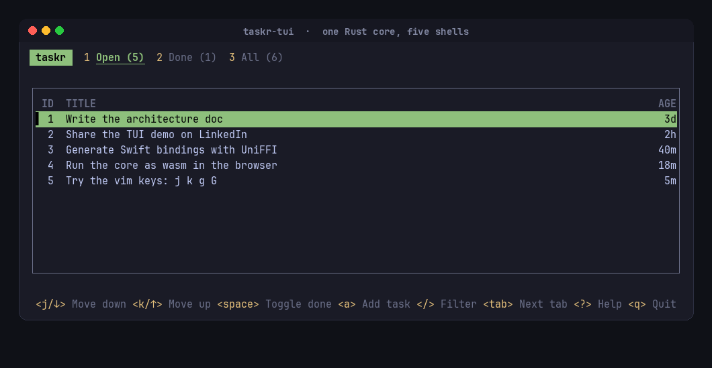

# taskr

A small task list that runs as a CLI, a TUI, a web app, an Android app and an iOS app, all driven by one Rust core. Signed out, tasks stay on the device; signed in, the same core talks to a multi-user server with workspaces, roles and Supabase Auth. It is the reference implementation of the **Core and Shells** pattern described in [docs/architecture.md](docs/architecture.md).



- Domain: `tasks` (the `TaskList` aggregate: unique open titles, an open-task limit, complete and reopen rules) and `workspaces` (members, roles, always one owner)
- Cross-cutting infrastructure: `telemetry` (one port, five destinations: stderr, a log file, the browser console, logcat, os_log)

## Layout

```text
crates/
  taskr-core/     domain, use cases, ports, shared ViewModel state machine (no I/O, no deps)
  taskr-infra/    native adapters: JSON file storage, system clock, JSON-lines telemetry
  taskr-cli/      `taskr` binary (clap)
  taskr-tui/      `taskr-tui` binary (ratatui, vim keys, k9s-style hints)
  taskr-ffi/      UniFFI facade for Kotlin and Swift
  taskr-wasm/     wasm-bindgen facade for the browser, generates the TypeScript types
  taskr-api/      the HTTP contract (paths, JSON bodies, error codes) shared by server and client
  taskr-client/   HTTP and Supabase Auth adapters for the client ports (native and wasm)
  taskr-postgres/ Postgres adapters with a transactional outbox (sqlx)
  taskr-server/   `taskr-server` binary (Axum), the use cases behind a JSON API
apps/
  web/            Svelte 5 + TypeScript + Vite, runs the core as wasm; Vitest, Storybook, Playwright
  android/        Kotlin + Jetpack Compose
  ios/            Swift + SwiftUI, XcodeGen spec
scripts/          build and smoke-test scripts for each platform
deploy/dev/       Docker Compose: Postgres + Supabase Auth (GoTrue) for local work
docs/             architecture.md, thoughts.md, the roadmap, milestone notes
book/             the study guide (EPUB and PDF), built from Markdown
```

## Run it

The CLI and TUI share data in `$TASKR_HOME` (default: the platform data dir, for example `~/.local/share/taskr`).

```sh
cargo test --workspace                      # 144 tests: domain, use cases, presentation, adapters, shells, HTTP

cargo run -p taskr-cli -- add Buy milk
cargo run -p taskr-cli -- list --scope all
cargo run -p taskr-cli -- done 1
cargo run -p taskr-cli -- -v list --json    # -v prints telemetry to stderr

cargo run -p taskr-tui                      # ? shows every key; signed in after `taskr login`
```

### Web

```sh
./scripts/build-web.sh                      # needs wasm32-unknown-unknown and wasm-bindgen-cli 0.2.128
cd apps/web && npm install
npm run smoke                               # the real wasm core under Node
npm run dev                                 # http://localhost:5173
npm run build                               # svelte-check + production build
npm run test:ci                             # Vitest: desktop and mobile views, models, every story
npm run e2e                                 # Playwright on desktop and a Pixel 7, against a real server
npm run storybook                           # http://localhost:6006, every screen state
```

Every web screen has a desktop view and a phone view (`views/desktop`, `views/mobile`), both pure. Stories and component tests render fixtures the Rust core writes to `src/lib/core/fixtures.json`.

### Android

```sh
./scripts/gen-bindings.sh                   # Kotlin bindings, works on Linux without the SDK
JNA_JAR=path/to/jna-5.18.1.jar ./scripts/smoke-kotlin.sh   # bindings on the JVM
./scripts/setup-android-toolchain.sh        # JDK, Gradle, SDK, NDK, cargo-ndk for this user (asks to accept SDK licenses)
./scripts/build-android.sh                  # TASKR_ANDROID_BUILD_STD=1 TASKR_ANDROID_ABIS=x86_64 without rustup
```

Then open `apps/android` in Android Studio, or build with Gradle. The Gradle `preBuild` step runs `build-android.sh`. Add `-Ptaskr.apiUrl=http://192.168.240.1:8787/api` for the signed-in app on Waydroid (`-Ptaskr.authUrl=...` for Supabase Auth, otherwise dev sign-in); without it the app keeps tasks on the device.

### iOS

On Linux (before Xcode):

```sh
./scripts/gen-bindings.sh                   # Swift bindings + C header + modulemap
./scripts/smoke-swift.sh                    # bindings + TasksModel + AppModel with a Linux Swift toolchain
```

On a Mac:

```sh
./scripts/build-ios.sh                      # static libs, xcframework, xcodegen
open apps/ios/Taskr.xcodeproj
```

### Server (signed-in mode)

```sh
TASKR_STORAGE=memory TASKR_DEV_AUTH=1 cargo run -p taskr-server     # throwaway, any email signs in
cargo run -p taskr-cli -- login --server http://localhost:8787/api --email ada@example.com --dev
cargo run -p taskr-cli -- add Ship it                                # now goes to the server
cargo run -p taskr-cli -- members set bob@example.com viewer
cd apps/web && VITE_TASKR_API=/api npm run dev                       # sign-in, sidebar, members
```

With real Postgres and Supabase Auth, see [docs/milestones/m1-multi-user.md](docs/milestones/m1-multi-user.md#how-to-run-it). `TASKR_TEST_DATABASE_URL` turns on the Postgres tests.

## The book

`book/` is a study guide built around this repository: the pattern, clean architecture, and primers on Rust, Svelte, Kotlin and Swift. Code listings are checked against the source on every build.

```sh
./scripts/build-book.sh          # book/build/core-and-shells.epub (Kindle) and .pdf (iPad)
./scripts/build-book.sh --check  # only check that listings still match the code
```

Needs node, pandoc 3.8+ and a Chromium (Playwright's is found automatically, or set `CHROME_PATH`).

## What was verified where

| Shell | Verified on this Linux machine |
|---|---|
| CLI | unit and process-level tests, manual run, remote mode against the server with dev auth and with GoTrue |
| Server | HTTP end-to-end tests on memory and Postgres; Supabase JWTs from a GoTrue container |
| TUI | unit and render tests, driven in a real pty, shares data with the CLI; signed in against the server |
| Web | wasm built, Node smoke test, svelte-check, production build; 52 Vitest tests (views, models, every story); 10 Playwright tests on desktop and Pixel 7 against a real server; driven by hand with GoTrue |
| Android | built with Gradle and the NDK, installed and run on Waydroid (x86_64), signed in through GoTrue against the dev stack |
| iOS | Swift bindings and `TasksModel` ran with Swift 6.4 on Linux in the first edition; the new `AppModel` and SwiftUI screens are written but not compiled (no Swift toolchain here now, SwiftUI needs macOS) |
