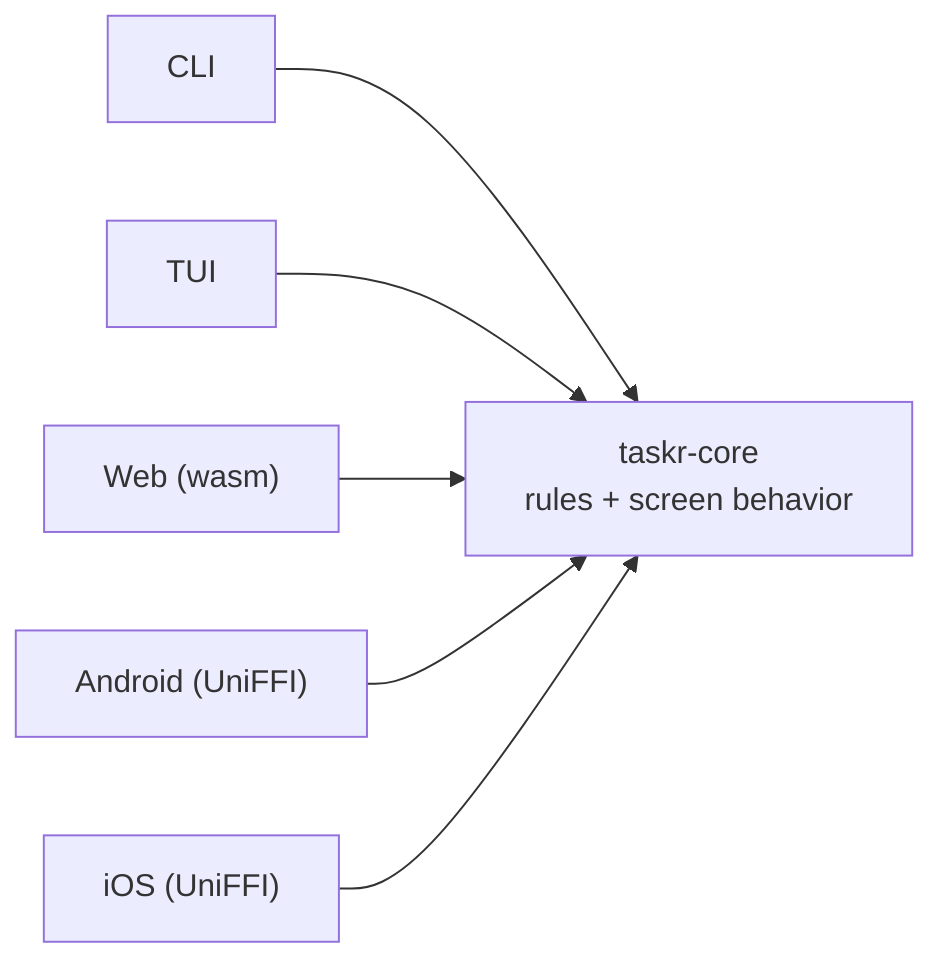

# Why one core

## The five-copies problem

Imagine the first version of a product. A web app, built with care: components, a ViewModel per screen, a repository per data source, tests. Then the product grows.

Someone wants a CLI for scripting. Someone wants a mobile app. Power users ask for a keyboard-driven terminal UI. Each of these gets built by someone who reads the web code and writes "the same thing" again, in another language.

A year later, here is what the code base looks like:

- The rule "two open tasks cannot have the same title" exists in five places. Three of them ignore case. One trims whitespace first.
- The error message for that rule exists in five wordings.
- The empty state says "No tasks" on web, "Nothing here yet" on iOS, and nothing at all in the TUI.
- A bug fix for the filter lands on web and Android. Nobody remembers the other three.
- Every new feature costs five times, and the estimates say so.

None of these are bugs in the usual sense. They come from the shape of the code. The same knowledge is written down five times, so it drifts five ways.

## What should be written once

If you look at a screen in any of those apps and ask "who decided this?", the answers sort into two piles.

**Decided by the product:** which tasks appear, in what order, what the counts on the tabs are, what happens when you tap a task, which message appears when something goes wrong, when a button is allowed, what "age" means and how it's formatted. A product manager could write a user story about every one of these.

**Decided by the platform:** that iOS uses a segmented control and Android uses tabs, that the TUI moves with `j` and `k`, that the web app has a focus ring, that mobile apps must not block the main thread, that the CLI prints JSON when asked.

The first pile should be written once. The second pile should be written per platform, and it should be *thin*.

## The goal

> Write every rule and every screen behavior once, in Rust, and keep each platform a thin shell that only draws and forwards input.

The goal is met when:

1. A business rule lives in exactly one place: the domain.
2. A screen behavior lives in exactly one place: the presentation state machine.
3. A shell contains no `if` that a product manager would care about.
4. Every port has an in-memory fake and a contract test, so the whole core is tested without disk, network, clock or UI.
5. Adding a platform means writing a facade and a renderer, never touching the core.

These five rules are the yardstick for the rest of the book. Whenever a design choice comes up, the question is: does it keep these true?

## Why Rust for the core

The core has to run everywhere: natively on Linux, macOS and Windows for the CLI and TUI, inside Android and iOS apps, and inside a browser. Very few languages do all of that well.

Rust does, for concrete reasons:

- **It compiles to everything the shells need.** Native binaries, static and dynamic libraries for mobile, and WebAssembly for the browser, from the same source.
- **No runtime or garbage collector to embed.** A Rust library inside an iOS app is just a static library. Inside a browser it's a 200 KB wasm file.
- **Mature binding generators.** UniFFI generates Kotlin and Swift. wasm-bindgen generates JavaScript glue. `ts-rs` generates TypeScript types. You write the boundary once, in Rust.
- **The type system is good at modeling a domain.** Enums with data, exhaustive `match`, `Result` for errors and private fields for invariants make illegal states hard to write. You'll see this in chapter 5.

The cost is learning Rust, and the build pipeline for mobile and web is more involved than a single-platform app. Part three shows exactly what that pipeline looks like.

## Alternatives, briefly

- **One cross-platform UI framework** (Flutter, React Native, Kotlin Multiplatform with Compose). This shares UI as well as logic, which is great until you want a truly native feel or a terminal UI. Core and Shells shares logic and leaves UI native. The two ideas can also be combined.
- **A thin client for everything over an API.** The web, mobile and CLI all call a server. Simple, but every client still needs screen logic, nothing works offline, and the CLI can't work without a network.
- **Share the domain, duplicate the ViewModels.** This is the most common approach, and it gets you halfway. The rules stay in one place, but screen behavior still drifts. Chapter 6 is about closing that gap.

## Meet taskr

The sample is deliberately small, so it's easy to read and still covers everything:

- **One bounded context**, `tasks`, with real invariants: unique open titles, a limit on open tasks, rules for completing and reopening.
- **One cross-cutting concern**, telemetry: the core records what happened, and each platform sends it somewhere different.
- **Five shells**: `taskr` (CLI), `taskr-tui` (terminal UI with vim keys), a Svelte web app running the core as WebAssembly, a Jetpack Compose Android app and a SwiftUI iOS app.

By the end of part three you'll have seen every line that matters in all of them.
