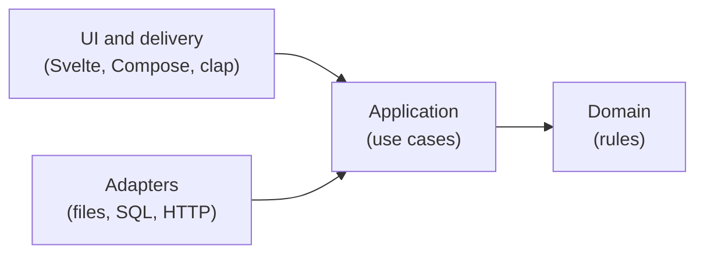
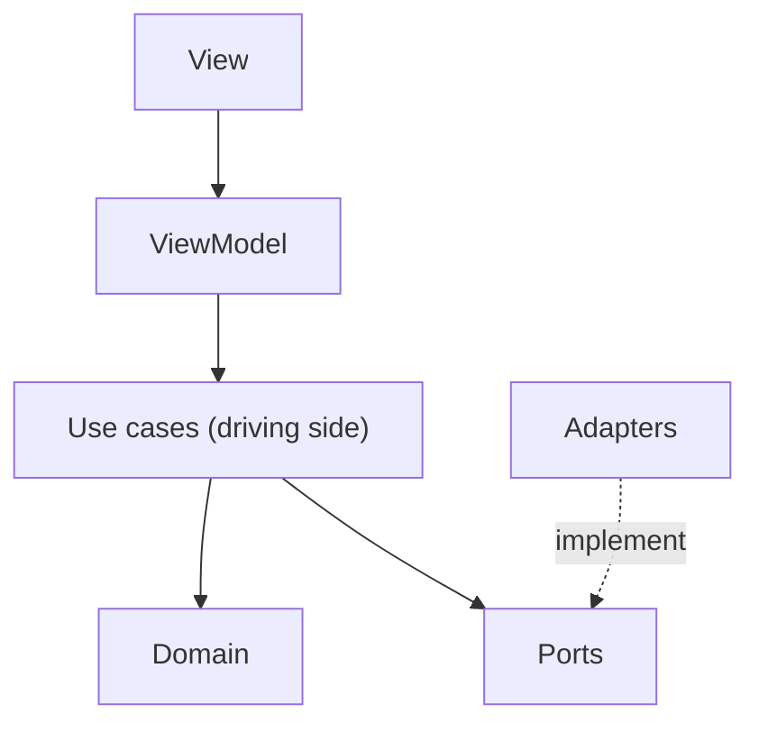

# Clean architecture, without the ceremony

"Clean architecture" gets used to mean a lot of things, often a folder layout with many layers and interfaces everywhere. This chapter strips it down to the few ideas that actually pay off, and shows how domain-driven design, hexagonal architecture and MVVM fit together.

## The one rule: dependencies point inward

Everything else follows from this:

> Code that holds the most important, most stable knowledge must not depend on code that is more detailed or more likely to change.

Business rules change when the business changes. Databases, UI frameworks and HTTP libraries change when technology changes. Those are different rates of change for different reasons, so they shouldn't be tangled together. Put the rules in the middle and let everything else depend on them, never the other way round.



The interesting arrow is the one from the database to the application. A use case needs to load and save data, so how can the database depend on it and not the other way round? The answer is the most useful trick in the whole subject.

## Ports and adapters (hexagonal architecture)

The application layer **defines an interface for what it needs**, in its own words. That interface is a *port*. Infrastructure **implements** it. That implementation is an *adapter*.

```rust
pub trait TaskListRepository: Send + Sync {
    fn load(&self) -> Result<TaskList, StorageError>;
    fn save(&self, list: &TaskList) -> Result<(), StorageError>;
}
```

The use case only knows this trait. A JSON file, a SQLite database, the browser's `localStorage` and an in-memory fake for tests are all adapters, and the use case can't tell them apart. The source dependency now points inward, from the adapter to the trait, even though at runtime the call goes outward.

There are two kinds of ports:

- **Driven ports** (outbound) are things the core calls: repositories, clocks, telemetry, email senders, payment gateways.
- **Driving ports** (inbound) are how the outside calls the core: the use cases themselves, or a facade over them. A CLI command, an HTTP handler, a button tap and a message from a queue all drive the core through them.

Alistair Cockburn drew this as a hexagon with the app in the middle and adapters around the edge, which is where the name comes from. The number of sides doesn't mean anything.

::: tip
A port belongs to the code that **uses** it, not the code that implements it. `TaskListRepository` lives next to the use cases in `app.rs`, not in the infrastructure crate. If you find yourself designing a port by looking at what a database can do, you are designing it from the wrong side.
:::

## Domain-driven design: the useful parts

Domain-driven design (DDD) is a big book with a strategic half and a tactical half. You need a small piece of each.

### Strategic: bounded contexts and ubiquitous language

A **bounded context** is a part of the product with its own consistent model and vocabulary. In a bigger taskr, "task" in the *tasks* context (a to-do with a title) and "task" in a *scheduling* context (a job on a worker) would be different things, and that's fine as long as each context is clear about its own meaning.

The **ubiquitous language** is the vocabulary the team and the users share, and it appears verbatim in the code. If users say "complete a task" and "reopen it", the methods are `complete` and `reopen`, not `setStatus(2)`. If a word in the code would confuse a product manager, that's a smell.

In taskr each bounded context is a module: `taskr-core/src/tasks/`. A second context (say `billing`) would be a sibling module, or its own crate once it gets big.

### Tactical: the building blocks

- **Entity**: has an identity that stays the same while its attributes change. A `Task` with id 3 is the same task after you rename it.
- **Value object**: defined only by its value, immutable, and valid by construction. A `Title` is a string that is trimmed, not empty and at most 80 characters, and there is no way to build an invalid one.
- **Aggregate**: a cluster of entities and values treated as one unit for changes, with one **root** that guards the invariants. All changes go through the root. In taskr the aggregate is the whole `TaskList`, because its rules ("no two open tasks share a title", "at most 50 open tasks") can only be checked by looking at all the tasks together.
- **Repository**: loads and saves whole aggregates. Not rows, not individual fields.
- **Domain service**: a rule that doesn't belong to one entity, like a pricing calculation that needs a customer and a catalog. Use it sparingly.
- **Domain event**: a fact that happened (`task.completed`). taskr records these as telemetry today. Chapter 12 turns them into real events.

### The anemic model trap

The most common DDD mistake is a domain made only of data, with all the rules in "service" classes:

```typescript
// Anemic: the entity is a bag of fields
interface Task { id: string; status: string }

class TaskService {
  complete(task: Task) {
    if (task.status !== "open") throw new Error("already done");
    task.status = "done";
  }
}
```

Nothing stops another piece of code from writing `task.status = "done"` directly and skipping the check. In a **rich model** the rule lives on the entity and the field is private, so the only way to change the status is through the method that checks it. Rust makes this natural: struct fields are private to their module unless you mark them `pub`.

## MVVM, and where it fits

Model-View-ViewModel splits a screen into:

- **View**: draws the screen from data it's given, and reports user actions. No logic.
- **ViewModel**: holds screen state and turns user actions into calls to the model, then exposes the result as data for the view.
- **Model**: everything behind it, meaning domain, use cases and data access.

MVVM answers "how do I structure a screen", and hexagonal and DDD answer "how do I structure what's behind it". They fit together like this:



### What the React developer guide does

The frontend developer guide this book started from uses four layers: **Page** creates infrastructure clients and repositories, **Container** receives repository *interfaces* through props and wires a ViewModel, **ViewModel** holds "business logic and state", and **View** is pure, props only. Dependencies are injected through props rather than React Context so a Storybook story can render a container by passing a fake repository.

That is hexagonal architecture expressed in React. The Page is the composition root, the repository interface is a port, the props are constructor injection. All of it carries over to this book.

One thing changes. In the guide, the ViewModel holds business logic. With one UI that's fine. With five UIs it would mean five copies of the business logic, which is exactly the problem from chapter 1. So in Core and Shells:

- Business **rules** move down into the domain.
- Business **operations** (load, apply a rule, save) move into use cases.
- What's left of the ViewModel, the **screen behavior**, moves into shared Rust too (chapter 6).
- The platform keeps a thin **container** that holds the latest view and forwards actions.

## Domain, infrastructure, or UI facade?

Not every piece of code deserves DDD. The developer guide has a test that works well, and this book uses it everywhere:

> If stakeholders don't talk about it in business terms, it's not domain.

| | Domain | Infrastructure | UI facade |
|---|---|---|---|
| Example | tasks, billing, subscriptions | logging, clock, navigation, theming, key bindings | settings page, dashboard |
| Business rules | yes | no | no, it delegates |
| Entities and repositories | yes | no | no |
| Shared across features | no, one context | yes | no, usually one page |
| Where in taskr | `taskr-core/src/tasks/` | `taskr-core/src/shared/`, adapters, shells | a shell, composing several contexts |

A mobile navigation drawer has no business rules, so giving it a `DrawerAggregate` and an `INavigationRepository` is over-engineering. A settings page that shows your subscription and your privacy choices is a *facade*: it composes two contexts and owns no rules itself. Putting a price calculation there would be a mistake. That rule belongs in the subscription context.

## Composition roots and dependency injection

Somebody has to choose the real adapters and plug them in. That place is the **composition root**, and there should be exactly one per program: `main` in a binary, the activity or app struct in a mobile app, the page in a web app.

Everything below the composition root receives its dependencies through constructors (or props). No globals, no singletons, no service locators. Two reasons:

1. **Tests can pass fakes.** A use case built from an in-memory repository and a fixed clock is deterministic and fast.
2. **Dependencies are visible.** A constructor that takes five ports tells you the use case does too much. A hidden global never tells you anything.

In taskr, every composition root is short enough to read in one go. Here is the TUI's:

```{.rust file="crates/taskr-tui/src/main.rs"}
    let home = paths::data_dir();
    let clock = Arc::new(SystemClock);
    let telemetry: Arc<dyn Telemetry> =
        match JsonLinesTelemetry::append_to(&paths::log_file(&home), Level::Info, clock.clone()) {
            Ok(t) => Arc::new(t),
            Err(_) => Arc::new(NoTelemetry),
        };
    let remote = RemoteConfig::load(&home).and_then(|c| c.auth().map(|auth| (c, auth)));
    // ...
    let shell = match remote {
        Some((config, auth)) => {
            let auth: Arc<dyn AuthClient> = Arc::from(auth);
            let sessions = Arc::new(FileSessionStore::new(paths::session_file(&home)));
            let api = Arc::new(HttpApi::new(config.server.clone(), sessions.clone()));
            let app = AppController::new(auth, sessions, api.clone(), api, clock);
            let runtime = tokio::runtime::Builder::new_current_thread().enable_all().build()?;
            Shell::remote(app, runtime, config.server, config.dev)
        }
        None => {
            let repo = Arc::new(JsonFileTaskListRepository::new(&home));
            Shell::new(TaskListController::local(Tasks::new(repo, clock, telemetry)))
        }
    };
```

Read it top to bottom: pick a clock, pick a telemetry destination, then pick where tasks live. Signed out, that is a JSON file and the use cases run in process. After `taskr login`, it is a server reached over HTTP, and the screen is driven by the app controller instead. Either way the rest of the TUI doesn't change, because both branches end in a `Shell` that only sees view models.

::: exercise
Pick an app you've worked on. Find one business rule and count how many places it's implemented. Then find its composition root. If you can't point at one, that is your first refactoring.
:::
