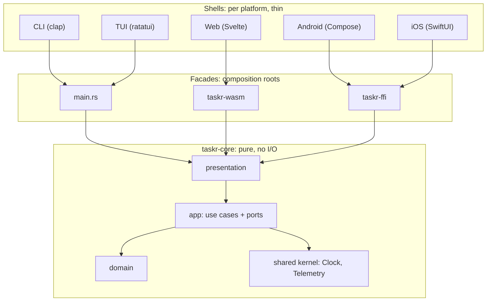
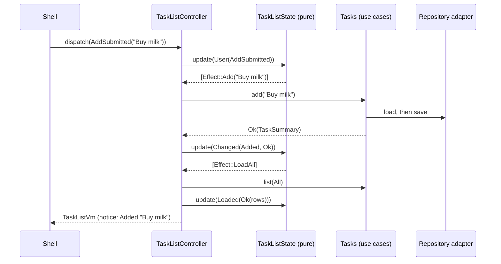

# The Core and Shells pattern

This chapter is the map. Everything after it zooms into one part.

## The shape



Seven kinds of code, each with one job:

| Layer | In taskr | Owns | Must not |
|---|---|---|---|
| Domain | `tasks/domain.rs` | entities, value objects, the aggregate, invariants, domain errors | know about storage, time sources, UI, serde |
| Application | `tasks/app.rs` | use cases, the ports they need, read models, the unit of work | return domain entities, format text for humans |
| Presentation | `tasks/presentation.rs` | screen state, intents, effects, the ViewModel, every user-facing string, fixtures | do I/O, know which platform renders it |
| Shared kernel | `shared/` | cross-cutting ports: `Clock`, `Telemetry` | contain business rules |
| Adapters | `taskr-infra`, `taskr-wasm/src/adapters.rs`, Kotlin and Swift sinks | implement ports for one environment | contain rules or screen logic |
| Facade | `main.rs` files, `taskr-ffi`, `taskr-wasm` | composition root and type translation at the boundary | contain logic beyond mapping |
| Shell | `apps/*`, the TUI's `shell.rs`, `view.rs`, `keymap.rs` | rendering, input, focus, navigation mechanics, threading | decide anything a user story talks about |

## The crates

```text
crates/
  taskr-core/     domain, use cases, ports, shared ViewModel (zero dependencies)
  taskr-infra/    native adapters: JSON file, system clock, JSON-lines telemetry
  taskr-cli/      the `taskr` binary
  taskr-tui/      the `taskr-tui` binary
  taskr-ffi/      UniFFI facade for Kotlin and Swift
  taskr-wasm/     wasm-bindgen facade for the browser
apps/
  web/  android/  ios/
```

`taskr-core` has **no dependencies at all**, not even `serde`. That's not purity for its own sake. It means the core compiles for every target without feature flags, and nothing in it can accidentally do I/O.

Rust code lives in `crates/`, and code in other languages lives in `apps/`. The TUI is a shell, but it's Rust, so it's a crate.

## How one tap flows through the system

Follow a user adding a task on any platform:



Three things to notice:

1. **The state machine never does I/O.** It only says what should happen next, as data (`Effect::Add`). That's what makes it trivial to test.
2. **The controller is boring on purpose.** It's a loop: run an effect, turn the result into an event, feed it back, repeat until there are no more effects.
3. **The shell gets one complete answer.** `TaskListVm` has everything it needs to draw the screen. It never has to compute a count or pick an error message.

## What the shell is allowed to own

A shell owns everything that's genuinely about its platform:

- cursor, scroll position, focus, selection highlight
- text being typed but not yet submitted
- navigation mechanics (push a screen, open a drawer, show a sheet)
- gestures, key bindings, accessibility wiring
- threading (calling the core off the UI thread)
- the platform's look: widgets, colors, spacing, icons

A useful test: *if this behavior changed, would a product manager write a ticket for it?* If yes, it belongs in the core. "Swipe to complete on mobile" is a shell gesture that sends `ToggleRequested`. "Completed tasks disappear from the Open tab" is core behavior.

## Cross-cutting concerns

Some concerns cut across every context and every shell: logging and telemetry, time, identity, feature flags. They get a **port in the shared kernel** and an **adapter per environment**.

taskr's example is telemetry. The core records what happened. Where it goes depends on the shell:

| Shell | Adapter | Goes to |
|---|---|---|
| CLI | `JsonLinesTelemetry::stderr` | stderr, JSON lines, only with `-v` |
| TUI | `JsonLinesTelemetry::append_to` | a log file (stderr would corrupt the screen) |
| Web | `ConsoleTelemetry` | the browser console |
| Android | `LogcatSink`, written in Kotlin | logcat |
| iOS | `OSLogSink`, written in Swift | unified logging |

The last two are interesting: the adapter is written in the platform's own language and handed to Rust through a callback interface. Chapter 10 shows how.

## Mapping to MVVM vocabulary

If you think in MVVM, here is the translation:

| MVVM / developer guide | Core and Shells |
|---|---|
| Model | domain + use cases |
| ViewModel (logic) | `TaskListState` + `TaskListController`, in Rust, shared |
| ViewModel (platform part) | a thin container: `TasksViewModel.kt`, `TasksModel.swift`, `taskListModel.svelte.ts` |
| View | `TaskListScreen` in Compose, SwiftUI, Svelte; `view.rs` in the TUI |
| Page / composition root | `main.rs`, the activity, the app struct, `App.svelte` |
| Repository interface | port trait |
| Storybook stories | `presentation::fixtures`, exported to every platform |

## Checking the goal

Back to the five rules from chapter 1, and where taskr enforces each:

1. **Rules once**: only `domain.rs` knows the title and uniqueness rules.
2. **Screen behavior once**: only `presentation.rs` decides rows, counts, messages and empty states.
3. **No product `if` in shells**: the Compose, SwiftUI and Svelte views only branch on fields of the ViewModel (`if error != null`), never on business meaning.
4. **Everything testable without I/O**: every port has a fake in `taskr-core/src/testing.rs`, and real adapters pass the same contract.
5. **New platform, no core change**: the web shell was added after the CLI and TUI, and `taskr-core` didn't change.
