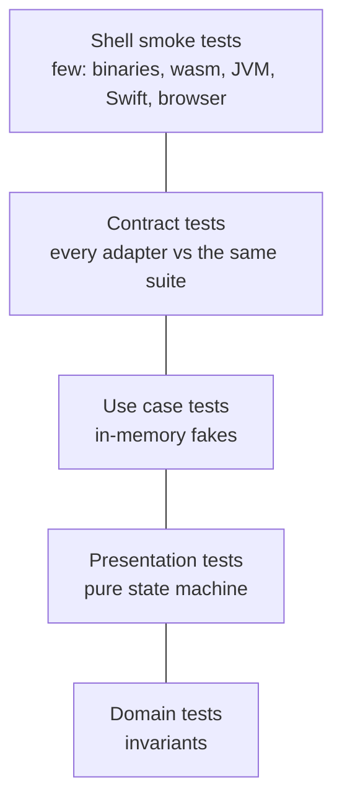

# Testing first

Core and Shells is designed so that almost everything worth testing is a plain function call with plain values. This chapter shows the test layers, why taskr uses fakes instead of mocks, and the outside-in TDD loop.

## The test pyramid, adjusted



| Where | What | Count |
|---|---|---|
| `taskr-core` | domain, use cases, presentation, fake contract | 30 |
| `taskr-infra` | JSON file contract, corrupt files, storage format, telemetry | 5 |
| `taskr-cli/tests` | the real binary: output, exit codes, telemetry | 4 |
| `taskr-tui` | key map, shell state, rendering | 12 |
| `taskr-ffi` | facade round trip with a recording log sink | 2 |
| `taskr-wasm` | TypeScript type generation | 8 |
| smoke tests | wasm under Node, Kotlin on the JVM, Swift on Linux | 3 |

All the Rust tests together run in well under a second.

## Fakes, not mocks

The React guide mocks repositories with `jest.fn()`. In Rust you can do that too (the `mockall` crate), but taskr writes small **fakes** instead: real, working, in-memory implementations of each port.

```{.rust file="crates/taskr-core/src/testing.rs"}
/// Stores a snapshot rather than the aggregate so every load goes through
/// `TaskList::restore`, exactly like the real adapters.
#[derive(Default)]
pub struct InMemoryTaskListRepository {
    stored: Mutex<TaskListSnapshot>,
    fail_saves: AtomicBool,
    saves: AtomicUsize,
}
```

Why fakes:

- **Tests read like behavior, not wiring.** "Add a task, then list" instead of "expect `save` to be called once with argument matching...".
- **Refactoring doesn't break them.** If a use case starts loading twice, a mock-based test fails. A fake-based test still passes, because the behavior didn't change.
- **One fake serves hundreds of tests.** A mock gets configured again in every test.

There are three fakes: `InMemoryTaskListRepository`, `FixedClock` and `RecordingTelemetry`. They live in `taskr-core/src/testing.rs` behind the `testing` feature, so the TUI's tests can use them too.

Mocks still have a place: asserting that something happened when there is no state to observe, like "an email was sent". Even then, a recording fake (like `RecordingTelemetry`) is usually clearer.

## Contract tests keep fakes honest

A fake is only useful if it behaves like the real thing. So every repository, fake or real, runs the same suite:

```{.rust file="crates/taskr-core/src/testing.rs"}
pub fn task_list_repository_contract<R: TaskListRepository>(
    fresh: impl Fn() -> R,
    reopen: impl Fn(&R) -> R,
) {
```

It checks that empty storage loads as an empty list, that what you save comes back equal (including non-ASCII titles), that data survives reopening the storage, and that a later save replaces an earlier one. The JSON file adapter runs it in `taskr-infra`:

```{.rust file="crates/taskr-infra/src/json_file.rs"}
    #[test]
    fn honours_the_repository_contract() {
        let dir = temp_dir("contract");
        task_list_repository_contract(
            || JsonFileTaskListRepository::new(dir.join("nested/tasks.json")),
            |r| JsonFileTaskListRepository::new(r.path()),
        );
        assert!(!dir.join("nested/tasks.json.tmp").exists());
    }
```

When a SQLite or Postgres adapter arrives, it gets one more call to the same function. If it passes, every use case test written against the fake is also valid for it.

## Testing each layer

### Domain

Plain values, no setup:

```rust
let mut list = TaskList::new();
list.add(title("Buy milk"), 0).unwrap();
assert_eq!(list.add(title("buy MILK"), 0), Err(TaskError::DuplicateOpenTitle));
```

### Use cases

A small `World` builds the use cases from fakes and keeps handles to them, so tests can check storage and telemetry:

```{.rust file="crates/taskr-core/src/tasks/app.rs"}
    #[test]
    fn rejected_add_changes_nothing_and_is_recorded() {
        let w = world();
        let err = w.tasks.add("   ").unwrap_err();
        assert_eq!(err, TasksError::Rejected(TaskError::InvalidTitle(TitleError::Empty)));
        assert_eq!(w.repo.save_count(), 0);
        let events = w.telemetry.events();
        assert_eq!(events.len(), 1);
        assert_eq!(events[0].level, Level::Warn);
        assert_eq!(events[0].get("action"), Some("task.added"));
    }
```

That one test checks the rule, the unit of work (nothing saved) and the cross-cutting concern (a warning recorded).

### Presentation

The state machine needs no fakes at all. Feed events, check effects and the view:

```{.rust file="crates/taskr-core/src/tasks/presentation.rs"}
    #[test]
    fn toggle_picks_complete_or_reopen_from_current_state() {
        let mut s = loaded(vec![summary(1, "a", false), summary(2, "b", true)]);
        assert_eq!(s.update(Event::User(Intent::ToggleRequested(1))), vec![Effect::Complete(1)]);
        assert_eq!(s.update(Event::User(Intent::ToggleRequested(2))), vec![Effect::Reopen(2)]);
        assert!(s.update(Event::User(Intent::ToggleRequested(9))).is_empty());
    }
```

This is the test the React guide writes as a Jest ViewModel test with mocked repositories. Here it's three lines with no mocks, because effects are data.

### Shells

Shell tests are few and coarse, because the shells are thin:

- **CLI**: run the real binary in a temp directory and check stdout, stderr and exit codes.
- **TUI**: drive `Shell::handle` with keys against a controller built from fakes, and render into ratatui's `TestBackend` to check what's on screen.
- **Web**: a Node script loads the real `.wasm` and runs a scenario; a headless browser run checks the page.
- **Mobile**: the generated Kotlin bindings run on a plain JVM, and the generated Swift bindings plus the iOS model run with the Linux Swift toolchain, both against the host build of the core.

## The outside-in loop

When building a feature, start from the outside of the core and move in:

1. **Presentation test.** Write the behavior the user sees: after adding, the notice says `Added "x"` and the list reloads. It fails.
2. **Use case test.** The presentation needs `Tasks::add`. Write its test with fakes. It fails.
3. **Domain test.** The use case needs `TaskList::add` to enforce uniqueness. Write that test. It fails.
4. **Make them pass, inside out.** Domain, then use case, then presentation.
5. **Contract.** If you added or changed a port, extend the contract suite and run it against every adapter.
6. **Shell.** Render the new field, send the new intent. Usually no new test, sometimes one smoke assertion.

Each step is seconds to run. You rarely start an app to find out whether a feature works.

::: tip
Name tests after the behavior, as a sentence: `a_done_title_can_be_reused`, `storage_failure_surfaces_and_is_recorded`. A failing test name should tell you what broke without opening the file.
:::

::: exercise
Finish the rename feature with tests at every layer:

1. Extend the controller test so a rename goes all the way through the in-memory repository.
2. Add a CLI subcommand `taskr rename <id> <title>` and one process-level test for its exit code when the title is taken.
3. In the TUI, bind `R` to a rename input mode. Add a `keymap` test that `R` isn't already bound.
:::
