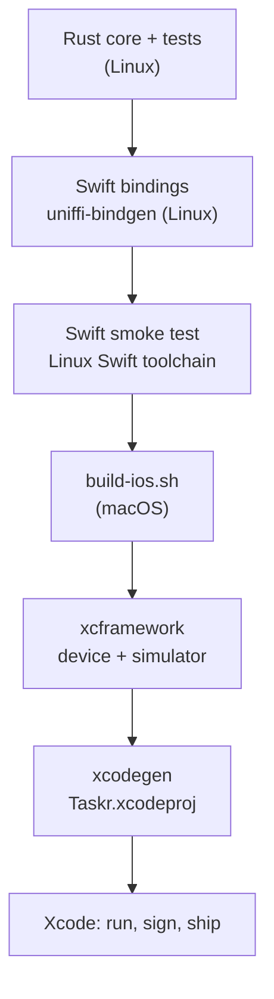

# The mobile shells: UniFFI, Kotlin and Swift

Mobile is where the pattern pays off most: two platforms, two languages, two UI toolkits, one core. This chapter covers the boundary (UniFFI), a quick primer on the Kotlin and Swift you need, and how to get as far as possible on Linux before you need a Mac.

## UniFFI in one page

UniFFI (from Mozilla) generates Kotlin and Swift bindings from annotated Rust. You mark what crosses the boundary, build the library, and run `uniffi-bindgen` against it:

| Rust | Kotlin | Swift |
|---|---|---|
| `#[derive(uniffi::Record)] struct` | `data class` | `struct` |
| `#[derive(uniffi::Enum)] enum` with data | `sealed class` | `enum` with associated values |
| `#[derive(uniffi::Object)] struct` + `#[uniffi::export] impl` | `class` (closeable) | `class` |
| `#[uniffi::export(callback_interface)] trait` | `interface` you implement | `protocol` you implement |
| `u32`, `String`, `Vec<T>`, `Option<T>` | `UInt`, `String`, `List<T>`, `T?` | `UInt32`, `String`, `[T]`, `T?` |

```sh
./scripts/gen-bindings.sh   # works on Linux, no Android SDK or Xcode needed
```

This writes `apps/android/app/src/main/java/dev/taskr/core/taskr_ffi.kt` and `apps/ios/Generated/` (a Swift file, a C header and a module map).

## Designing the boundary

Treat the FFI surface as a **public, versioned API**, because once an app ships, old app versions keep calling it. taskr follows four rules:

1. **Coarse-grained.** One object per screen, one call per user action. No chatty getters crossing the boundary in a loop.
2. **Own types.** The facade has its own records (`TaskListView`, `TaskIntent`). Domain types never cross, so the domain can change freely.
3. **Explicit threading.** Calls are synchronous and may touch disk, so shells must call them off the main thread. The presenter locks internally and is safe to share.
4. **Platform services come in as callbacks.** Anything the core needs from the platform is a callback interface implemented in Kotlin or Swift.

The whole mobile API is one object:

```{.rust file="crates/taskr-ffi/src/lib.rs"}
    #[uniffi::constructor]
    pub fn new(data_dir: String, sink: Box<dyn LogSink>) -> Self {
        let telemetry: Arc<dyn Telemetry> = Arc::new(ForeignTelemetry(sink));
        telemetry.record(LogEvent::info("app.started").field("shell", "mobile"));
        let repo = JsonFileTaskListRepository::new(paths::tasks_file(&PathBuf::from(data_dir)));
        let tasks = Tasks::new(Arc::new(repo), Arc::new(SystemClock), telemetry);
        Self { controller: Mutex::new(TaskListController::new(tasks)) }
    }

    pub fn dispatch(&self, intent: TaskIntent) -> TaskListView {
        let mut controller = self.controller.lock().unwrap_or_else(|e| e.into_inner());
        to_view(controller.dispatch(to_intent(intent)))
    }
```

### A port implemented in another language

Telemetry on mobile should go to logcat and os_log, which are platform APIs. So the facade declares a callback interface:

```{.rust file="crates/taskr-ffi/src/lib.rs"}
pub trait LogSink: Send + Sync {
    fn log(&self, level: LogLevel, event: String, fields: Vec<LogField>);
}
```

Kotlin and Swift implement it, and the facade wraps it in an adapter for the core's `Telemetry` port:

```{.rust file="crates/taskr-ffi/src/lib.rs"}
impl Telemetry for ForeignTelemetry {
    fn record(&self, event: LogEvent) {
```

The core can't tell this adapter from the JSON-lines one. The cross-cutting concern stays one port, and each platform fulfils it in its own language.

## A Kotlin primer for this shell

Kotlin is Android's main language. The parts this shell uses:

- **`val` and `var`**: read-only and mutable references. Prefer `val`.
- **Null safety**: `String?` may be null, `String` may not. `x ?: y` means "x, or y if x is null".
- **`data class`**: a record with `equals`, `hashCode` and `copy` generated. UniFFI records become these.
- **`sealed class`**: a closed set of subclasses, Kotlin's version of a Rust enum with data. `TaskIntent.AddSubmitted(title)` and `TaskIntent.Opened` are generated this way.
- **Coroutines**: `launch { ... }` runs code concurrently. `Dispatchers.IO` is a thread pool for blocking work.
- **`StateFlow`**: an observable value. Compose redraws when it changes.
- **Jetpack Compose**: UI as functions annotated with `@Composable`. They take data and lambdas, and Compose calls them again when the data changes.

### The Android container

The Android `ViewModel` survives screen rotation and holds the presenter. Its only job is threading:

```{.kotlin file="apps/android/app/src/main/java/dev/taskr/android/TasksViewModel.kt"}
class TasksViewModel(private val presenter: TaskListPresenter) : ViewModel() {
    // One lane, so intents reach the core in the order the user made them.
    @OptIn(ExperimentalCoroutinesApi::class)
    private val core = Dispatchers.IO.limitedParallelism(1)

    private val _view = MutableStateFlow<TaskListView?>(null)
    val view: StateFlow<TaskListView?> = _view.asStateFlow()

    init {
        send(TaskIntent.Opened)
    }

    fun send(intent: TaskIntent) {
        viewModelScope.launch(core) { _view.value = presenter.dispatch(intent) }
    }
```

`limitedParallelism(1)` makes a single lane on the IO pool. Calls never run on the main thread and never overtake each other, so "add, then complete" can't arrive at the core in the wrong order.

The logcat adapter is the port, implemented in Kotlin:

```{.kotlin file="apps/android/app/src/main/java/dev/taskr/android/LogcatSink.kt"}
class LogcatSink : LogSink {
    override fun log(level: LogLevel, event: String, fields: List<LogField>) {
        val message = (listOf(event) + fields.map { "${it.key}=${it.value}" }).joinToString(" ")
```

`TaskListScreen.kt` is a pure composable: `TaskListScreen(view, onIntent)`. Tabs, an add field, a filter, a message banner and a `LazyColumn` of rows. It shows the right-aligned, non-wide cells (the age) next to each title, which is how the shared column spec hides the id on a phone.

## A Swift primer for this shell

Swift is iOS's language. The parts this shell uses:

- **`let` and `var`**, and optionals (`String?`, `if let x { ... }`), much like Kotlin.
- **Value types**: `struct` and `enum` are copied, not shared. UniFFI records become structs, and enums with data become Swift enums with associated values: `.addSubmitted(title: "Buy milk")`.
- **Protocols**: Swift's interfaces. `LogSink` is a protocol you conform to.
- **`async`/`await` and actors**: an `actor` is a type whose methods run one at a time, off the caller's thread. Perfect for "call the core in order, not on the main thread".
- **`@MainActor`**: this code runs on the main thread, where UI state must live.
- **`@Observable`**: SwiftUI redraws views that read a property when it changes.
- **SwiftUI**: views are structs with a `body`. They're rebuilt from state, like Compose.

### The iOS container

```{.swift file="apps/ios/Taskr/TasksModel.swift"}
@MainActor
@Observable
final class TasksModel {
    private(set) var view: TaskListView?
    @ObservationIgnored private let lane: CoreLane

    init(presenter: TaskListPresenter) {
        lane = CoreLane(presenter: presenter)
    }

    func send(_ intent: TaskIntent) {
        Task { view = await lane.dispatch(intent) }
    }
}
```

```{.swift file="apps/ios/Taskr/TasksModel.swift"}
actor CoreLane {
    private let presenter: TaskListPresenter

    init(presenter: TaskListPresenter) {
        self.presenter = presenter
    }

    func dispatch(_ intent: TaskIntent) -> TaskListView {
        presenter.dispatch(intent: intent)
    }
}
```

The model lives on the main actor because SwiftUI reads it. Calls to the core hop to the `CoreLane` actor, which runs them one at a time off the main thread, the Swift equivalent of Android's single lane.

### Previews that use the real core

On iOS, Xcode previews run your app's code, including the Rust static library. So SwiftUI previews can render the core's own fixtures:

```{.swift file="apps/ios/Taskr/TaskListScreen.swift"}
#Preview("Sample") {
    TaskListScreen(view: previewScreens().first { $0.name == "sample" }?.view) { _ in }
}
```

Android Studio's preview renderer can't load native libraries, so the Compose previews build the same states in Kotlin. On a device, `previewScreens()` works on both.

## iOS before Xcode

Most of the iOS work happens on Linux:



- **On Linux**: the core and its tests, the generated Swift bindings, the SwiftUI sources, and an XcodeGen spec (`project.yml`) instead of a checked-in Xcode project. With the Linux Swift toolchain, `scripts/smoke-swift.sh` compiles the generated bindings plus `TasksModel.swift` and runs a scenario against the Linux build of the core. That checks the FFI contract, the callback interface and the actor-based threading without a Mac.
- **On macOS**: `scripts/build-ios.sh` cross-compiles the core for device and simulator, merges the simulator slices with `lipo`, wraps everything in an `.xcframework`, and runs `xcodegen`. From there it's ordinary Xcode: simulator, device, signing, TestFlight.

Android is similar: `scripts/smoke-kotlin.sh` compiles the generated Kotlin bindings on a plain JVM with JNA and runs the same kind of scenario against the Linux library. A full APK build needs the Android SDK, NDK and `cargo-ndk`, which `build-android.sh` drives and Gradle's `preBuild` step calls.

::: note
What's verified where, honestly: the bindings and the platform containers' threading are compiled and run on Linux. The Compose and SwiftUI views, the Gradle plugin versions and the XcodeGen spec are written but only build on a machine with the Android SDK or Xcode.
:::

::: exercise
Add a **share** action on mobile: long-pressing a task shares its title through the platform share sheet. Decide which parts are shell (the gesture, the share sheet) and which, if any, are core (the shared text format). Then add an `Effect::Share(text)` only if you decided the text is product behavior. Can you justify it either way?
:::
