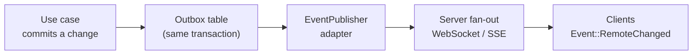
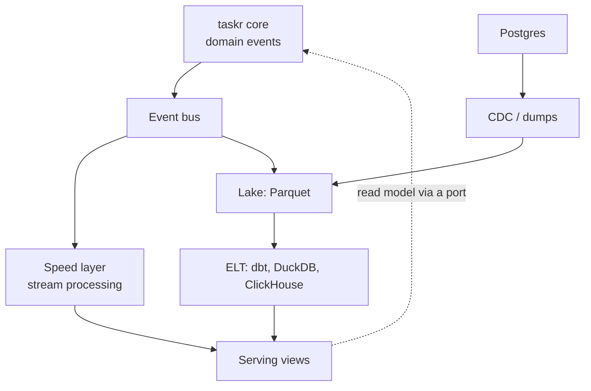

# Going distributed

So far taskr runs entirely on the user's device. This chapter adds a server, then everything that tends to arrive after one: Kubernetes, realtime updates, other services, analytics, a marketing site, content, and finally a family of apps that share one login. The theme is the same throughout: **the core doesn't change; new shells and new adapters appear at the edges.**

## The server is another shell

A server is a composition root with an HTTP front end, built over the same use cases. taskr has one since M1 (chapter 13):

```text
crates/taskr-server/
  main.rs      composition root: Postgres adapter, JSON-lines telemetry, Identity from Supabase JWTs
  lib.rs       axum routes: verify the caller -> call the API port -> encode the response
```

Route handlers contain no rules. They do what the CLI does: translate input, call a use case, translate the result (errors become HTTP status codes in one mapping, the way the CLI maps them to exit codes).

On the clients, the server shows up as **adapters**. taskr puts the seam one level above the repository: an HTTP implementation of the API ports (`TasksApi`, `WorkspacesApi`), so permissions and rules run on the server and the client only sends intents. A future offline mode adds a sync implementation behind the same ports. The web, mobile and CLI shells don't change, only their composition roots pick a different adapter.

## Fitting into Kubernetes

Cloud native mostly means behaving well at the edges. A checklist for `taskr-server`:

| Concern | How |
|---|---|
| Configuration | environment variables (12-factor), secrets from Kubernetes Secrets, one `Config` struct parsed at startup |
| Statelessness | no local state; storage is the Postgres adapter, so any pod can serve any request |
| Health | `/livez` (process is alive) and `/readyz` (ports are reachable, for example the database answers a ping) |
| Shutdown | stop accepting on SIGTERM, finish in-flight requests, then exit, within the pod's grace period |
| Telemetry | an OpenTelemetry adapter for the `Telemetry` port, exporting traces and logs over OTLP |
| Migrations | a Kubernetes Job or init container running the adapter's migrations before the new version starts |
| Image | a static musl build in a distroless image: small, no shell, fewer CVEs |
| Scaling | horizontal, safe because of statelessness and optimistic versions (chapter 11) |
| Delivery | Helm chart or Kustomize in `deploy/`, applied by CI or a GitOps tool |

Notice that every row is an adapter, a shell or deployment config. Nothing in the list touches `taskr-core`.

## Realtime updates

Should realtime come from the database (Supabase Realtime, Firebase) or from a Rust layer? **From the Rust layer**, with the database as one possible adapter.



- Use cases emit **domain events** (`task.completed`, with the task id and actor) after the change commits. An **outbox** row written in the same transaction guarantees no event is lost and none is sent for a rolled-back change.
- An `EventPublisher` port delivers them. One adapter could use Postgres `LISTEN/NOTIFY`, another NATS. Swapping is cheap.
- The server pushes events to connected clients over WebSocket or server-sent events, **after checking the policy** for each subscriber.
- Clients feed them into the presentation layer as one more event (`Event::RemoteChanged`), which reloads or patches the list. The state machine already knows how to reload.

Database-level realtime that streams rows straight to clients skips your policies, exposes your schema as an API, and ties you to one vendor. It's tempting for a prototype and painful later.

## Talking to other services

Use the tool that fits the conversation:

| Conversation | Tool | Why |
|---|---|---|
| "Do this and tell me the result now" | gRPC (`tonic`), or HTTP/JSON for public APIs | typed contracts, streaming, deadlines |
| "This happened" (facts other services react to) | a message bus: NATS JetStream to start, Kafka when you need a long, replayable log | decoupling in time; the publisher doesn't know the consumers |
| Schemas for both | Protobuf | one schema language for gRPC and for event payloads; Avro mostly makes sense if you're already deep in the Kafka ecosystem |

In the architecture:

- **Outbound** calls are ports with adapters, like everything else: `PricingClient`, `EventPublisher`.
- **Inbound** messages arrive through another shell: a consumer that decodes a message and calls a use case, exactly like an HTTP handler.
- Schemas live in a versioned `contracts` crate (or repository) shared by producers and consumers. Breaking changes get a new message type, not an edited one.

## Analytics: Lambda, Kappa and ELT

Analytics sits entirely **outside** the core, downstream of it. The core's only job is to emit well-defined, versioned domain events. Those events are the **data contract**, which is much more stable than raw tables.



- The **Lambda architecture** keeps a batch layer (recompute everything from the full history) and a speed layer (incremental, recent data) and merges them for serving.
- The **Kappa architecture** keeps only the stream, and reprocesses by replaying it. With a replayable log (Kafka, or JetStream with long retention) it's usually simpler, and it's the better default today.
- Results that flow back into the product (a "you usually finish tasks on Mondays" hint) enter through a port as a read model, like any other data.

## A mostly-static website

A marketing site with live-ish numbers (pricing, number of users) is another shell, and it never touches the database:

- Build it statically (Astro, or SvelteKit in static mode).
- Pricing is data owned by a **billing or catalog context**, not hardcoded in the site.
- The server exposes a small, public, read-only query use case (`GetPublicStats`) at an endpoint like `/public/stats`, cached at the CDN with `Cache-Control: max-age=300, stale-while-revalidate`.
- When pricing changes, a `pricing.changed` event triggers a rebuild webhook, so the static pages are never stale for long.

## Content: a blog that posts everywhere

Writing posts, translating them, and publishing them to several sites is its own **bounded context** with its own language: Post, Draft, Translation, Channel, Publication. So it's a **separate app** on the same platform crates, not more code in taskr.

Ports carry the moving parts:

- `Translator`, with an LLM adapter
- `Publisher`, with one adapter per destination (your blog, dev.to, LinkedIn, Medium)
- `MediaStore` for images

Before building it, check whether the workflow is the valuable part. Markdown in git plus a static site covers a plain blog with no app at all. The app earns its keep when translation review, scheduling and cross-posting are things you do every week.

## A family of apps on one platform

Once there are several apps (taskr, the content app, a billing app), share a **platform layer** and keep each app's contexts separate:

| Shared crate | What it standardizes |
|---|---|
| `kernel` | `Clock`, `Telemetry`, `Actor`, ids, the error taxonomy |
| `auth` | OIDC device flow for CLI and TUI, PKCE for web and mobile, token storage adapters (keyring, Keychain, Keystore) |
| `access` | roles, permissions, policy helpers and test fixtures |
| `presentation-kit` | generic table, list, filter and form state machines; the column spec; key map conventions |
| `shell-kit` per platform | the TUI frame and command palette, the web layout, CLI conventions (`--output json`, exit codes, `--context`) |

### One login, every app, kubectl style

The admin experience can copy kubectl and k9s directly:

- `org login` runs the device flow once and writes a shared token cache.
- `~/.config/org/config.yaml` holds **contexts**: which server, which tenant, which identity (an OIDC user or your mTLS super admin certificate). `org context use prod` switches.
- Every app's CLI and TUI read the same config and token cache, so you log in once.
- Each app **registers its resources**: name, columns, available actions and the permissions each action needs. That's exactly k9s's registry of renderers and views.
- One generic admin console (TUI, CLI and web) lists any registered resource. `:apps` switches app, `:tasks` or `:users` opens a table, actions appear only if your policies allow them, and CRUD goes through each app's own use cases.

The generic console is possible because of the choices made in the small sample: columns as data, keys as data, intents instead of callbacks, and policies inside use cases.

::: exercise
Design the resource registration for taskr: what does `taskr` tell the admin console about the `tasks` resource? Write it as a Rust struct: name, columns, actions with required permissions, and which use case each action calls. Then check it against the five goal rules from chapter 1.
:::
