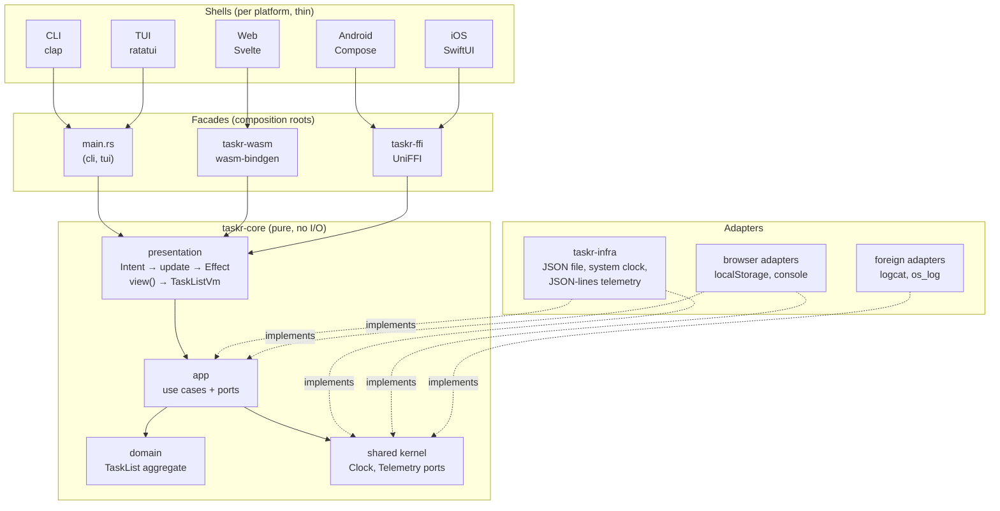

# Core and Shells: an architecture pattern for multiplatform Rust apps

## Goal

**Write every rule and every screen behavior once, in Rust, and keep each platform (CLI, TUI, web, Android, iOS) a thin shell that only draws and forwards input.**

The goal is met when all of these hold:

1. A business rule lives in exactly one place: the domain.
2. A screen behavior (what is listed, which message shows, what a tap does) lives in exactly one place: the presentation state machine.
3. A shell contains no `if` that a product manager would care about.
4. Every port has an in-memory fake and a contract test, so the whole core is tested without disk, network, clock or UI.
5. Adding a platform means writing a facade and a renderer, never touching the core.

`taskr` (this repository) is the reference implementation: one bounded context (`tasks`), one cross-cutting concern (`telemetry`), and five shells.

## The shape



Dependencies point inward. `taskr-core` has zero dependencies, not even `serde`.

## Layers

| Layer | Lives in | Owns | Must not |
|---|---|---|---|
| Domain | `taskr-core/src/tasks/domain.rs` | Entities, value objects, the aggregate root, invariants, domain errors | Know about storage, time sources, UI, serde |
| Application | `taskr-core/src/tasks/app.rs` | Use cases, the ports they need, read models (`TaskSummary`), the unit of work | Return domain entities to callers, format text for humans |
| Presentation | `taskr-core/src/tasks/presentation.rs` | Screen state, intents, effects, the ViewModel, every user-facing string, column specs, fixtures | Do I/O, know which platform renders it |
| Shared kernel | `taskr-core/src/shared/` | Cross-cutting ports (`Clock`, `Telemetry`) | Contain business rules |
| Adapters | `taskr-infra`, `taskr-wasm/src/adapters.rs`, Kotlin/Swift sinks | Implement ports for one environment | Contain business rules or screen logic |
| Facade | `taskr-cli`, `taskr-tui` `main.rs`, `taskr-ffi`, `taskr-wasm` | Composition root: pick adapters, build use cases, translate types at the boundary | Contain logic beyond mapping |
| Shell | `apps/*`, `taskr-tui/src/{shell,view,keymap}.rs` | Rendering, input, focus, cursor, navigation mechanics, threading | Decide anything a user story talks about |

### Domain

`TaskList` is the aggregate root. The whole list is one consistency boundary because the rules span tasks: open titles are unique (ignoring case), at most 50 tasks are open, a done task can only be reopened if that does not break uniqueness. `Title` is a value object that can only be built valid. Persistence goes through plain `TaskListSnapshot` data, and `TaskList::restore` re-checks every invariant, so a corrupt file can never produce an invalid aggregate.

### Application

Every write is one unit of work: load the aggregate, apply one domain operation, save it, record telemetry. Use cases own their ports:

```rust
pub trait TaskListRepository: Send + Sync {
    fn load(&self) -> Result<TaskList, StorageError>;
    fn save(&self, list: &TaskList) -> Result<(), StorageError>;
}
```

Ports are `Send + Sync` trait objects (`Arc<dyn Port>`) rather than generics, because UniFFI and wasm-bindgen cannot export generic types and the composition roots pick adapters at runtime.

### Presentation (the shared ViewModel)

This is the layer most architectures leave to each platform, and the one that duplicates fastest. It is split in two:

- `TaskListState` is a **pure state machine**: `update(Event) -> Vec<Effect>` and `view(now) -> TaskListVm`. No I/O, no async, no mocks needed to test it.
- `TaskListController` is a tiny runtime: it runs each `Effect` through the use cases and feeds the result back as an `Event`. Shells call `dispatch(Intent) -> TaskListVm` and render what comes back.

```text
user taps "Add"
  → shell sends Intent::AddSubmitted("Buy milk")
  → update() returns [Effect::Add("Buy milk")]
  → controller runs Tasks::add, gets Ok(summary)
  → update(Event::Changed(Added, Ok)) sets the notice, returns [Effect::LoadAll]
  → controller runs Tasks::list, update(Event::Loaded) stores rows
  → view(now) builds TaskListVm { tabs, rows, notice: "Added \"Buy milk\"", ... }
  → shell renders it
```

`TaskListVm` carries everything a renderer needs, already decided: tab labels with counts, filtered rows, one formatted cell per column, the column spec (title, alignment, and a k9s-style `wide` flag so narrow screens can drop columns), empty-state text, error and notice text. `describe()` is the only place errors become words, so every platform says exactly the same thing.

`presentation::fixtures` provides named screens (`empty`, `loading`, `sample`, `error`). They are exported through both facades and drive SwiftUI previews, Storybook-style checks and snapshot tests. One fixture set, every platform renders the same states.

### Shells: what stays native

Shells keep what is genuinely platform specific: cursor and scroll position, focus, text input buffers, navigation mechanics, gestures, accessibility wiring, threading. The TUI is the clearest example: `shell.rs` holds the cursor and input mode, `view.rs` is a pure function of that state, and `keymap.rs` is a table.

## Cross-cutting concerns

Telemetry is the worked example. The core records *what happened*; each shell decides *where it goes*:

| Shell | Adapter | Destination |
|---|---|---|
| CLI | `JsonLinesTelemetry::stderr` | stderr, JSON lines, only with `-v` |
| TUI | `JsonLinesTelemetry::append_to` | `$TASKR_HOME/taskr.log.jsonl` (stderr would corrupt the screen) |
| Web | `ConsoleTelemetry` | browser console |
| Android | `LogcatSink` (Kotlin, via UniFFI callback interface) | logcat |
| iOS | `OSLogSink` (Swift, via UniFFI callback interface) | unified logging |

The use cases emit `task.added`, `task.completed`, `task.reopened`, `task.rejected` (with the reason) and `storage.failed`. Because the port is in the shared kernel, every bounded context can use it, and because there is a `RecordingTelemetry` fake, tests assert on telemetry like any other output.

`Clock` follows the same pattern and is what makes ages ("3d", "5m") deterministic in tests.

**Rule for deciding:** if stakeholders talk about it in business terms, it is domain. If it is reusable plumbing (logging, time, storage, navigation, theming, key bindings), it is infrastructure or shell, and it gets a simple port or utility, not aggregates and repositories.

## Mapping to the frontend developer guide (MVVM + DDD)

| Developer guide (React) | Here |
|---|---|
| `features/<feature>/` bounded context | `taskr-core/src/<context>/` |
| `domain/` entities and value objects | `<context>/domain.rs` |
| `services/I*Repository.ts` interface | port trait in `<context>/app.rs` |
| `services/*Repository.ts` | adapter in `taskr-infra` or a facade crate |
| ViewModel (business logic + state) | split: use case in `app.rs`, screen state in `presentation.rs` |
| View (pure, props only) | `TaskListScreen` in Svelte, Compose, SwiftUI; `view.rs` in the TUI |
| Container | `taskListModel.svelte.ts`, `TasksViewModel.kt`, `TasksModel.swift`, `shell.rs` |
| Page (creates clients and repositories) | composition root: `main.rs`, `TaskListPresenter::new` in each facade |
| Props-based DI | constructor injection of `Arc<dyn Port>`; the web view takes a `TaskCore` interface |
| Storybook stories | `presentation::fixtures`, exported as `previewScreens()` |
| Jest ViewModel tests with mocks | pure `TaskListState` tests, no mocks needed |
| Infrastructure vs domain rule | same rule, see "Rule for deciding" |

The one deliberate change: the guide's ViewModel holds business logic. With five UIs that would mean five copies, so business logic moves down into the domain and use cases, and the remaining screen logic moves into shared Rust.

## TDD workflow

Work outside in. Each step has a fast, deterministic test:

1. **Presentation**: write the screen behavior as `TaskListState` tests. Given a state, send an event, assert `view()` and the effects. No fakes needed.
2. **Use case**: test `Tasks` with `InMemoryTaskListRepository`, `FixedClock`, `RecordingTelemetry`.
3. **Domain**: test invariants on `TaskList` and `Title` directly.
4. **Adapter contract**: every repository runs `task_list_repository_contract`, the same suite the in-memory fake passes. This is what keeps fakes honest.
5. **Shell**: few tests. TUI: key handling against the real controller with fakes, plus `TestBackend` render checks. CLI: process-level tests for output and exit codes. Web: a Node smoke test of the real wasm build plus a browser run. Mobile: smoke tests that compile the generated Kotlin and Swift bindings (and the iOS container) on Linux and run them against the host library.

| Where | What | Count |
|---|---|---|
| `taskr-core` | domain, use cases, presentation, fake contract | 30 |
| `taskr-infra` | JSON file contract, corrupt files, storage format, telemetry | 5 |
| `taskr-cli/tests` | process-level: output, exit codes, telemetry | 4 |
| `taskr-tui` | keymap, shell state, rendering | 12 |
| `taskr-ffi` | facade round trip with a recording `LogSink` | 2 |
| `taskr-wasm` | generates the TypeScript types | 8 |
| `apps/web/scripts/smoke.mjs` | real wasm under Node | 1 |
| `apps/android/smoke` | generated Kotlin bindings on the JVM, `LogSink` callback | 1 |
| `apps/ios/smoke` | generated Swift bindings plus the iOS `TasksModel`, on Linux Swift | 1 |

## Platform decisions

**Web runs the core in WebAssembly.** The alternative (a thin Svelte client over an HTTP API) would duplicate the presentation logic in TypeScript and leave the web without offline support. With wasm, the web gets the same controller as every other shell, storage is `localStorage` behind the same repository port, and the TypeScript types are generated from Rust by `ts-rs`, so they cannot drift. An Axum server becomes the sync backend later, not the web app's only brain.

**Mobile goes through UniFFI, coarse grained.** One object per screen (`TaskListPresenter`), one `dispatch` per user action, plain records out. Domain types never cross the boundary. Calls are synchronous and may touch disk, so shells call them off the main thread: a single-lane dispatcher on Android, an actor on iOS, both preserving the order of user actions. Platform services enter the core as callback interfaces (`LogSink`).

**iOS from Linux.** Everything up to Xcode runs on Linux: the core, its tests, the Swift bindings, the SwiftUI sources and the XcodeGen spec. `scripts/build-ios.sh` is the macOS half: cross-compile for device and simulator, build the `.xcframework`, generate the Xcode project.

**The TUI follows k9s.** Keys are data (`keymap.rs`), the hint bar and help overlay are generated from that table, vim motions (`j k g G ctrl-d ctrl-u`), `/` filter, `esc` to clear, number keys and `tab` for scopes. Columns come from the shared column spec, exactly like k9s renderers produce a header and rows for a generic table.

## Adding a feature (checklist)

1. Name it in the ubiquitous language. If nobody outside engineering would name it, it is not domain.
2. Domain: add the rule to the aggregate, with a failing test first.
3. Application: add or extend a use case; if it needs the outside world, add a port and a fake, and extend the contract.
4. Presentation: add the `Intent`, the `Effect`, the state change and the `TaskListVm` field. Add a fixture if it is a new screen state. Add its message to `describe()`.
5. Facades: map the new types in `taskr-ffi` and `taskr-wasm/src/dto.rs`, then run `scripts/gen-bindings.sh` and `cargo test -p taskr-wasm` to regenerate Kotlin, Swift and TypeScript.
6. Shells: render the new field, send the new intent. If a shell needs an `if` about business meaning, go back to step 4.

## Known limits and next steps

- **Ports are synchronous.** Fine for local files and `localStorage`. Network and sync will need async ports; the effect/event loop already separates "what to do" from "doing it", so only `TaskListController::run` and the facades change.
- **No sync engine yet.** IDs are sequential per device. Sync will need client-generated IDs (UUIDv7), an outbox, and conflict rules that live in the domain, not in infrastructure.
- **Concurrent writers.** CLI and TUI share one file. Each write reloads first and writes atomically, but two simultaneous writers are last-writer-wins.
- **Mobile UI code is not compiled here.** The generated Kotlin bindings run on the JVM, and the generated Swift bindings plus `TasksModel.swift` compile and run with the Linux Swift toolchain. The Compose and SwiftUI views, the Gradle plugin versions and the XcodeGen spec are written but unbuilt until an Android SDK and a Mac are available.
