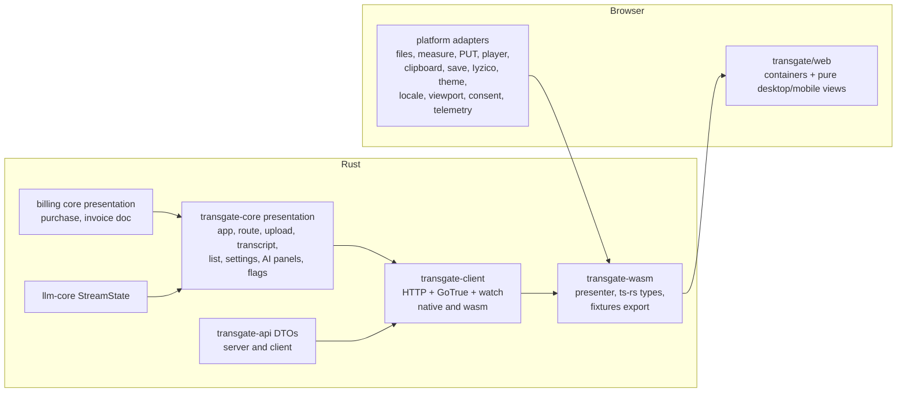

# P5 web app proposal (Opus)

Advisor `w23:p1V`, preserved Opus session, 2026-10-25. Independent proposal: the Sol proposal was not read and no design was discussed with Sol. Read-only source review; no implementation, build, test, formatter, browser or provider call. Claims about current Rust code cite the files read. Statements marked **[INFERENCE]** are design reasoning, not observed behavior.

Evidence read: `docs/prd.md` §1-3, §7-8; `docs/plans/p5-web/brief.md`; `transgate/docs/discovery/screens.md` (all 76 WEB rows) and the web rows of `parity.md` from the billing, privacy-identity, AI, jobs, API, platform and languages ledgers; P2/P3/P4 decisions and the P4 host/shell/policy handoffs; `transgate/core/src/presentation/*`, `transgate/core/src/ai/presentation.rs`, `transgate/api`, `transgate/http`, `transgate/server`, `transgate/billing`, `modules/billing/{core/src/presentation.rs,http/src/routes.rs}`, `transgate/export`; `apps/web`, `crates/taskr-{client,wasm,core}`, `scripts/gen-tokens.py`, `design-tokens.json`, `deploy/dev/compose.yaml`, `docs/gates.md`; and the cited source Transgate files (read only).

## 0. Position in one paragraph

P5 is mostly a **renderer and client problem on top of existing Rust state machines**, plus a short list of real backend seams that the web flows need and that no phase built: effective capabilities (FLG), profile facts, job feedback, support mail, invoice and analysis document bytes, a browser-shaped checkout confirmation and the static app serving path. Each one must be implemented or explicitly sequenced, never mocked. The new code is one Transgate client crate (native and wasm), one wasm presenter crate and `transgate/web`. They follow the taskr pattern already executed in P4: Rust controllers over async ports, shell adapters for browser-only mechanics, generated TypeScript types and Rust-generated fixtures. No TypeScript business state machine, no taskr-core dependency and no change to taskr.

## 1. Bounded clause and flow inventory

### 1.1 Row counts in scope

`parity.md` has 205 web rows: 111 desktop and 94 phone. They belong to P5 or a named later phase as follows.

| Group | Rows | P5 role |
|---|---|---|
| WEB-001..048 (screens) | 48 | Owner of rendered flows, except the parts named in 1.3 |
| WEB-BIL-001..031 | 31 | Owner (desktop/phone pairs), except WEB-BIL-018/019 (throw) and 030/031 (P6 pricing) |
| WEB-IDN-001..024 | 24 | Owner, except WEB-IDN-009/010 (homepage popup on `/`, P6 surface) |
| WEB-PRV-001..020 | 20 | Owner, except WEB-PRV-017..020 (legal pages, P6) |
| AI-F01..F10 | 10 | Owner of rendered AI flows; P4 backend is consumed, not reimplemented |
| JOB-F01..F16 | 16 | Owner |
| API-F08/F09 | 2 | **P7 dependency** (API keys), see 1.3 |
| OPS-P001..P004 | 4 | Owner (effective visibility, consent-gated browser telemetry) |
| SEO-* web rows | 50 | **P6**, not P5 |
| LOC-001..016 | 16 | Owner for app routes; static pages are P6 |
| WEB-049..076 | 28 | **P8** shells; P5 claims none of them |

### 1.2 P5 flow inventory

Every row below is a desktop and phone pair unless marked otherwise. "Backend" names the existing route or a P5 gap from section 2.4.

| Flow | Rows | Backend today | P5 gap |
|---|---|---|---|
| Sign in, sign up, magic link, Google, recovery, set password, signed-in redirect, protected-route redirect, sign out | WEB-001..004, WEB-IDN-001..008, 011..020, 023/024 | GoTrue (`/token`, `/signup`, `/otp`, `/recover`, `/user`, `/authorize`), JWT verify in `transgate/billing/src/identity.rs` | GoTrue client beyond password grant; refresh; route guard |
| Cookie consent banner, consent-gated PostHog/Sentry | WEB-005/006 (app part), WEB-PRV-011/012, OPS-P003/P004 | none (browser only) | browser adapters |
| Upload, restore drafts, preparation states, YouTube add/resolve, translation configuration | WEB-007..014, JOB-F01..F08, WEB-BIL-024/025, WEB-PRV-015/016 | `/api/jobs` POST, `/api/jobs/options`, `/api/init-upload`, `/api/v1/transcriptions`, `/api/youtube/{add,metadata,resolve}`, `/api/languages/usage`; `presentation::upload_queue` | controller, browser file/measure/PUT adapters |
| History list, sidebar, paging, refresh, delete | WEB-015/016, JOB-F15/F16, WEB-PRV-013/014, WEB-BIL-001/002 | `/api/jobs` GET, `/api/jobs/{id}` DELETE, `/api/billing/overview`; `presentation::job_list` | controller; phone filters/swipe/pull adapters |
| Live transcript, playback, edit, speakers, translation tabs, freemium cut | WEB-017..024, JOB-F09..F12, WEB-BIL-026/027 | `/api/jobs/{id}`, `/api/jobs/{id}/lines`, `/api/jobs/lines` PATCH, `/api/streaming-url`; `presentation::transcript` | controller; player adapter (HTML audio, YouTube iframe) |
| Export ZIP, copy | WEB-025/026, JOB-F13/F14 | `/api/jobs/{id}/export` (P3, server bytes) | save adapter; UI-01 decision |
| AI consent gate, analysis stream/reload/retry/copy/export, chat stream/limits/copy/retry/rate/download | WEB-027..030, AI-F01..F10, WEB-PRV-009/010 | `/api/ai/*`, `/api/v1/ai/{analyze,chat}` (P4) | analysis and chat panel state machines; analysis document bytes |
| Feedback | WEB-031/032 | **none** | `job_feedback` use case and route |
| Support | WEB-033/034 (+ API-F38, EML-006) | **none** | support use case, route, mail |
| Balance, purchase modal/sheet, coupon, checkout handoff, success/failure, special-client alert | WEB-035/036, WEB-BIL-001..014, 028/029 | `/api/billing/{overview,catalog,quote,coupon/{id},checkout}`, `/checkout/confirm` (JSON) | purchase state machine; browser confirm page |
| Invoice history, PDF preview/download, admin lookup and Bill To | WEB-037/038, WEB-BIL-015..017 | `/api/billing/history`, `/api/billing/admin/customer-invoices` | invoice PDF bytes; capability for lookup |
| Settings: profile/theme/locale, AI tab, subscription view/cancel, manage data, delete account | WEB-039..044, WEB-IDN-021/022, WEB-BIL-020..023, WEB-PRV-001..010 | `/api/settings`, `/api/ai/consent`, `/api/billing/{overview,cancel-subscription}`, `/api/jobs` DELETE, `/api/delete-account`; `presentation::data_management` | settings shell state; profile facts |
| Effective feature visibility | OPS-P001/P002, FLG-001..009 | **none** (flags are not implemented in Rust) | `flags` evaluation and `/api/me` |
| Locales | LOC-001..016, LNG-001..006 | languages fixtures and `transgate/core/src/languages.rs` | catalog, path prefixes, fallback manifest |

### 1.3 Explicit cross-phase dependencies, not placeholders

- **P7, API keys (WEB-045/046, API-F08/F09) and `/dashboard`.** No key use case exists in Rust. The production-facts note says API users are live, so the screen cannot be thrown away. Rendering it over an absent endpoint is forbidden. **Proposal:** P5 does not ship the user-menu "API Keys" entry or `/dashboard*` routes. P7 delivers the key use cases, routes and both views together on the P5 shell, scaffolding and fixtures. IDN-025's menu item stays red until then.
- **P7, `/api-docs` and `/api-reference` (WEB-047/048, docs part).** These are generated from P7 OpenAPI.
- **P6, public routes.** These are `/` with the homepage Google popup (WEB-005 popup part, WEB-IDN-009/010, UI-03), `/contact`, `/contact/success`, `/certification/{id}`, legal pages (WEB-PRV-017..020), pricing (WEB-BIL-030/031) and public 404 (WEB-047/048). P5 owns the app 404 fallback and the cookie banner in app routes. P5 also publishes the session-presence contract P6 needs for "signed-in visitor on `/` goes to `/{locale}/home`" (WEB-IDN-015/016, LNG-004); see decision P5-D9.
- **P8.** WEB-049..076 consume the same `transgate-client` controllers later. P5 makes no claim about them.
- **Thrown or excluded, which needs canonical `dropped` records.** These are `/NewBilling`, `/InvoiceForm` (WEB-BIL-018/019), disabled dashboards (UI-02), `/voice-agent-test` (P4 D6) and the legacy duplicate `/home/all-transcripts/all-transcripts`. `docs/gates.md` accepts `dropped` only with an explicit `mu approved` record. Until the lead records it, WEB-BIL-018/019 stay red; P5 renders nothing for them.
- **Kept as route aliases.** `/new-signin` and `/home/all-transcripts` are kept as aliases of `/signin` and `?view=all-transcripts`, because the source serves them.

## 2. Client, presentation, binding and view split

### 2.1 Reused symbols, unchanged

- `presentation::upload_queue::{UploadQueueState, Event, Effect, UploadQueueVm, MAX_FILES, poll_interval_ms, accept_dropped, DESKTOP_PICKER_ACCEPT, PHONE_PICKER_ACCEPT}` already encodes UPL-001..021/025/027/028, JOB-003/005 and LNG-008/011/012.
- `presentation::transcript::{TranscriptState, Event, Effect, TranscriptVm, RUNNING_POLL_MS, COMPLETION_DELAY_MS}` covers EDT-001..014, EXP-001/012..016, TRX-042 and LNG-007. Its `Effect::Download { bundle, event }` already carries the export decision.
- `presentation::job_list::{JobListState, status_label, status_tone, Tone, duration_text}` and `presentation::data_management::{DataManagementState, Confirm}` cover the PRV-D01 intended sign-out order.
- `presentation::fixtures` provides named screen states for stories.
- `ai::presentation::{GenerationView::frame, analysis_events, staleness, public_error}`; `llm_core::{StreamState, ApplicationFrame}`; and `llm_http::{ApplicationDecoder, SseDecoder}` (portable, already used from wasm by `taskr-client`).
- `billing_core::presentation::{balance_text, current_plan, renewal_notice, next_payment_date, subscription_view, history_row, invoice_id, confirm_analytics, CONFIRM_COUNTDOWN_SECONDS}` and `billing_core::pricing` quote rules.
- The `transgate_core::export` model plus `transgate_export` ZIP/OOXML writers.
- Server routes listed in 1.2, unchanged in shape.

### 2.2 New pure presentation, the only new business-facing state

These state machines live in `transgate/core/src/presentation/`, except the billing modal, which lives in `modules/billing/core/src/presentation/`. They follow the existing `update(event) -> Vec<Effect>` and `view() -> Vm` shape. Each one is a port of a named source view model; none of them invents a rule.

| Module | Source it ports | Responsibility |
|---|---|---|
| `app` | `_app.tsx`, `withUserProfile.tsx`, `useLogout.ts`, `useTransgateUser.tsx` | Session epochs (the taskr `Epoch` pattern), restore/refresh/expiry, protected-route redirect, current route, capabilities, display name rule (IDN-026), balance refresh every 30 s (WEB-BIL-001), navigation model (sidebar/drawer state is shell-local) |
| `route` | `pages/home/[[...jobId]].tsx`, LNG-002 | `parse(path, query) -> Route` and `href(Route, Locale)`: `/{locale}/home`, `?view=new|all-transcripts`, `/home/{jobId}`, `/billing`, `/signin`, `/new-password`, `/checkout/confirm`. The phone `view=new` redirect (MOBL-116) is an intent the shell sends with its device class |
| `settings` | `SettingsContainer.tsx`, `SettingsView.tsx`, `SubscriptionView.tsx` | Tab model (profile, AI, subscription, manage data); composes `data_management` and consent; subscription cancel confirm (WEB-BIL-022/023) |
| `ai_consent` | `AIFeatureWrapper.tsx`, `consent-service.ts` | Intro, accept/decline, revoke confirm "Confirm Disable AI Features"; the gate precedes content (WEB-027) |
| `analysis_panel` | `useAnalysisSummaryViewModel.ts` | Cache read, AI-008 staleness, generate once when consent and lines exist, progressive sections from `AnalysisEvent`, D8 interrupted-with-partials, retry (new request key), copy and export intents |
| `chat_panel` | `useChatViewModel.ts`, `useChatLimits.ts` | History load, limits display, send (D5 original question kept), stream through `llm_core::StreamState` with D1/D4 replacement, unsaved-final warning instead of the AI-021 "sync warning", retry, rate (telemetry only, see below), copy and download text |
| `feedback`, `support` | `FeedbackModal.tsx:86-118`, `SupportModal.tsx:14-48` | Rating 0/5/10 plus optional comment (data-model `job_feedback` CHECK); message plus job context |
| `checkout` | `checkout/index.tsx:75-129`, `confirm.tsx:25-118` | Handoff decision (form scripts or redirect URL), start-failure page, confirm result, 5 s countdown to `/{locale}`, one-time purchase analytics from `ConfirmView.analytics` |
| `invoices` | `pages/billing/index.tsx:339-716` | Completed-payment rows (reuses `history_row`), preview/download intents, capability-gated admin lookup and temporary Bill To text (never persisted) |
| `billing_core::presentation::purchase` | `BillingModalContainer.tsx`, `useBillingViewModel.ts:146-223`, `PayAsYouGoCard.tsx:37-215`, `PaymentSummary.tsx:93-152` | Package cards, monthly/yearly toggle, PAYG presets 5/10/25, typed hours, minimum-5 warning (CPN-005), coupon apply/error/check (CPN-008..013), terms acceptance, quote and checkout effects; prices always come from `/api/billing/quote` (P2 D2) |
| `flags` (pure, `transgate/core/src/flags.rs`) | `featureFlags.ts:18-248` | FLG-001 evaluation (global true, else email/user/locale match) over host configuration; the result is a `Capabilities` struct, never allow-lists sent to the browser |

**Message keys instead of English text.** Existing presentation returns English source text: chip labels, `loading_message`, `Confirm::title`, and others. `data_management.rs` states its copy is the source's translation keys. P5 adds `presentation::msg::Msg { ns: Ns, key: &'static str, args }`, with `Ns ∈ {common, app, ai, transcription, translation, dashboard}`, and migrates every copy-bearing VM field to it. A Rust test asserts every key reachable from fixtures exists in the vendored `en` catalog (section 4). This touches P3/P4 presentation files, so it needs the owners' coordination (section 5).

**Chat rating** is a telemetry event only in source: `Transcript.tsx:299-301` calls `chatEvents.messageRated`. It stays a telemetry effect, never a stored field.

### 2.3 Client, binding and shell seams

**`transgate/client` (new crate, native and wasm32 via reqwest, mirroring `taskr-client`).** Port implementations:

- `JobsApi`, `AiApi`, `BillingApi` (uses `billing_http` DTOs where public), `SettingsApi`, `AccountApi` (feedback, support, delete account, `me`).
- `GoTrueAuth`: password grant, signup, `/otp` magic link with `redirect_to`, `/recover`, `PUT /user` (new password), `refresh_token` grant, the Google `/authorize?provider=google&redirect_to=` URL builder, and parsing of the redirect fragment session.
- Shared-codec watch: `ApplicationDecoder` for text, `SseDecoder` for analysis named events.

The controllers own effect execution. The client holds no product rule. It is intentionally separate from `taskr-client` (decision P5-D3).

**`transgate/wasm` (new).** `TranscriptionAppPresenter::new(config, platform)` exposes `dispatch(intent, onView?) -> Promise<AppView>`, `current()` and `dispose()`. It also provides `fixtures()`, plus a `#[cfg(test)]` exporter that writes `transgate/web/src/lib/core/{types/*.ts, fixtures.json}` (the taskr-wasm pattern). Browser adapters in Rust: `localStorage` session (`transgate.session`), clock, and console log.

**`platform` JS port.** Injected into the presenter and implemented in TypeScript, because browser objects (`File`, media elements, scripts) cannot cross into Rust usefully.

- **Files.** `PickedFile` gains an opaque shell `handle: u64` (additive field). The shell keeps `Map<handle, File>` and never zips results by index.
- **Measure (UPL-006).** HTML5 metadata with a 5 s timeout, else Web Audio decode up to 100 MB with a 10 s timeout. It returns `Measured { file, seconds }`.
- **Upload (UPL-013).** XHR `PUT` of the `File` to the `init-upload` URL and headers, reporting progress; only HTTP 200 counts; one attempt.
- **Player.** HTML audio from `/api/streaming-url` (UPL-016, 900 s URL refreshed on expiry error), or the YouTube iframe API. It provides play/pause/seek/state and reports `PlayerState`.
- **Others.** Clipboard; save `Blob` (filename from the core bundle); mount Iyzico form scripts into `#iyzipay-checkout-form` or assign `location.href` to the payment URL; Turnstile widget (when configured); theme; locale navigation; viewport class; cookie consent; PostHog/Sentry.

**`transgate/web` (new Svelte 5 + Vite + Tailwind).**
- One container per screen, choosing `views/desktop/*` or `views/mobile/*`. Views are pure: props in, intents out, only UI mechanics as local state (hover, swipe offset, scroll, sheet drag).
- Device class reproduces source `useDeviceType`: phone views for **touch and innerWidth < 1024**, not taskr's `max-width: 720px`. `MOBILE_UX_JOBS`/`MOBILE_UX_AI` come from capabilities (both globally on, FLG-003).
- The phone landscape blocker is preserved as a shell mechanic (`_app.tsx:53-74`, keep-knowledge).

**Server (`transgate/server`).**
- Serve the built app with `ServeDir` and an `index.html` fallback for app routes, including locale prefixes. `/api/*`, `/checkout/confirm` POST and provider routes are mounted first. Unknown `/api/*` stays JSON 404, never `index.html`.
- `TRANSGATE_WEB_DIR` mirrors `TASKR_WEB_DIR` (`crates/taskr-server/src/main.rs:137-138`).
- The Dockerfile gains a Node build stage and copies `dist` into the runtime image (P1 packaging decision: one image, Axum serves the app).

### 2.4 Backend gaps P5 must close or sequence honestly

| Gap | Evidence | Proposal | Owner |
|---|---|---|---|
| Effective capabilities and profile facts | No Rust flag evaluation exists (grep found only `show_original` parameters); FLG-001..009; IDN-026; WEB-IDN-021/022 | `GET /api/me` → `{account, email, displayName, joinedAt (email_confirmed_at), locale?, capabilities{ai, aiChat, youtube, showOriginal, mobileUxJobs, mobileUxAi, mobileExpandedPlayer, billingHistory, customerLookup, microphone=false, drives=false}, isFreemium, unlimitedHistory, specialClient?}`. Allow-lists stay server configuration. `BILLING_CUSTOMER_LOOKUP` stays server-enforced too (FLG-007) | core `flags`, host route |
| Job feedback | `job_feedback` keep-throw "port, small, in use"; no Rust code | `POST /api/jobs/{id}/feedback {rating: 0\|5\|10, feedback?}` with owner check and erasure barrier; rows removed by erasure and hard delete (PRV-005) | core jobs use case and store, host |
| Support message | API-F38, EML-006 (support first, then acknowledgement); no route | `POST /api/support {message, jobId?}` → two outbox mails through the existing `Mailer` port, in source order | core and host mail |
| Browser checkout confirmation | `routes.rs` `confirm` returns JSON; source renders a page and fires the GA purchase event (`confirm.tsx:45-117`) | When `Content-Type` is form and `Accept` includes HTML, the host calls the same billing `confirm_checkout` and returns the app `index.html` with the `ConfirmView` embedded as escaped JSON (`<` written as `\u003c`) in `<script type="application/json" id="tg-confirm">`. The SPA renders success/failure, a 5 s countdown and one-time analytics. A GET keeps the source invalid-method failure page. No PRG is used, because the analytics intent must survive and the payment must not be reconfirmed | billing http plus host |
| Invoice PDF | Source builds it in the browser with `@react-pdf` (`billing/index.tsx:155,507-544`); BIL-075 rows | Core document model `billing_core::presentation::InvoiceDoc` (exact fields: invoice id `TRAN%08d`, `dd/MM/yyyy`, amounts, Bill To fallback). The bytes come from `GET /api/billing/invoices/{payment}.pdf` and an admin `POST` variant carrying the looked-up customer and temporary Bill To (BIL-076 gates). The preview is the same bytes in an `<iframe>` | billing module |
| Analysis export DOCX/PDF/TXT/MD | Source exporters run client-side (`components/AIAnalysis/export/*`) with a CDN-loaded Noto Arabic font | Core builds the format-neutral document from the typed analysis. TXT/MD are pure core; DOCX uses the existing `transgate_export` OOXML writer; PDF uses one pure-Rust writer with embedded fonts. Exposed as `POST /api/ai/jobs/{job}/analysis/export {format}` | content owner (model), host (bytes) |
| Chat/analysis start without SSE parsing | `/api/v1/ai/{chat,analyze}` answer legacy SSE (`hosts.md` lines 45-46) | Additive content negotiation: `Accept: application/json` returns `Started` (as `retry` already does), then the client attaches the shared watch. Legacy SSE stays for source-compatible callers | AI host owner |
| App static serving and Docker web stage | `transgate/Dockerfile` builds only the server | As in 2.3 | integration owner |

The source's realtime change feed is a keep-throw "gap, web shell topic" (`keep-throw.md:130`). **Proposal:** keep the source's own fallback, already encoded in Rust: 2 s job polling while running (`RUNNING_POLL_MS`), lines after completion (`COMPLETION_DELAY_MS`), draft polling per UPL-008, and the AI shared watch. No new push channel in P5 (decision P5-D6).

### 2.5 Mechanics that must stay out of shells

- **Session loss.** Every effect carries the epoch. A late answer for an old session is dropped, the taskr precedent in `session/presentation.rs:37-41`. A 401 tries one refresh grant. Failure clears the session and replaces the route with `/signin` (WEB-IDN-017/018). The source shows a spinner first; the view shows a loading state while `restoring`. A 410 `account_erased` is terminal: sign out, show the erased message, no retry (P3 D13).
- **Routing.** The history API is the shell's job. `Route` parse/format is core. The language switcher does a full page load to `/{code}/home` and writes no cookie (LNG-002).
- **Upload/media progress.** Progress percentages, measurement and PUT are shell adapters; queue, gating and alerts are core (UPL-007/008).
- **Editor/player.** Pause-on-edit/resume is the core effect `PausePlayer`/`ResumePlayer` (EDT-001); seek is `Effect::Seek`; the active-line highlight comes from the player's current time, which is shell-local.
- **Streaming.** Only `StreamState` decides replacement. The view renders `view().text` and its status. One-way snapshot replacement follows D4, using the reconnect cursor `durable_seq` (P4 shells handoff).
- **Destructive operations.** Every confirm text and order comes from `Confirm`, `JobListState::confirm_delete`, the subscription cancel confirm and the consent revoke confirm. Account deletion follows PRV-D01 intended (sign out only after server success). The UI never claims "fully erased" from a request; `ErasureView` is the authority (P3 D15).
- **External checkout.** The shell only mounts Iyzico scripts or redirects to a hosted URL. The page keeps its white background and secure-payment logo footer (`checkout/index.tsx:89-127`). GET `/checkout` keeps the source redirect home (`:151-156`).

## 3. Source-preserving step order

Desktop and phone differ only where the source differs. Exact step order comes from the cited lines; restyling uses tokens, never reordering.

| Flow | Desktop order | Phone order | Source |
|---|---|---|---|
| New transcript | YouTube beta banner (when enabled) → mode tabs → drop zone. Empty: blank state and plus menu. With files: file list → mode language selectors with speakers toggle → plus menu (hidden at 10 files) → Start | Header/drawer → total duration line ("Calculating..." while unknown) → large source buttons (file, YouTube) → files list with swipe-left hint → configuration section → fixed bottom Start ("Starting...", "Preparing files...", "Start Translating/Transcribing") | `TranscriptionWorkspace.tsx:183-278`; `MobileNewTranscript.tsx:180-316` |
| Phone entry | n/a | `/home` without job or view is replaced by `?view=new` | `[[...jobId]].tsx:85-90` |
| Start | Write options to drafts, start, navigate to the first job. A balance refusal shows the not-enough-balance alert with "Add minutes" | same | UPL-007, JOB-005, WEB-BIL-024/025 |
| YouTube | Dialog → add (draft with metadata) → resolve at Start → navigate. Errors per `youtube_error_message`; blocked user 403 `Account suspended` | same, via source button | `useTranscriptionViewModel.ts:880-967`; WEB-PRV-015/016 |
| Transcript | Sidebar → fixed title/player header → transcript and AI-analysis tabs → resizable Ask AI panel. YouTube uses the embedded-player layout | Transcript/analysis/chat tabs, swipe navigation, sticky player, action sheet | `Transcript.tsx:634-860`; `MobileJobDetailsView.tsx:168-254` |
| Edit | Pencil (hover) → edit → Enter/check saves, Escape/cross cancels → playback resumes if it was playing | same container | EDT-001..006 |
| Export | Primary download (toggle-aware) and "all formats" | Action-sheet download; source omits toggles (UI-01) | EXP-011..013 |
| History | Table (name, status, duration, date, actions), infinite scroll, delete confirm | Cards, filters, swipe delete, pull to refresh | `JobListTable.tsx:163-467`; `MobileJobListView.tsx` |
| AI | Consent intro, accept/decline → analysis tab (generate once) → sections stream → copy/export dropdown. Ask AI panel: limits, input, streamed answers, copy/retry/rate, download | Analysis tab and chat tab with the same states | `AIFeatureWrapper.tsx:9-33`; `DesktopSummaryView.tsx:149-272`; `DesktopChatView.tsx:166-309` |
| Purchase | Balance → billing modal (PAYG card, monthly/yearly, Premium/Business, summary with coupon and Turkish-card note, terms) → Pay with Card → `/checkout` handoff → Iyzico → `/checkout/confirm` | Drawer balance → bottom sheet with the same sections → same handoff pages | WEB-BIL-001..014 |
| Invoices | Table ≥ `sm`, preview modal, download; admin lookup and Bill To when capable | Cards < `sm` with download | `billing/index.tsx:339-716` |
| Settings | Modal with four tabs: profile (email, Joined on, Appearance theme, language switcher), AI features, subscription, manage data | Same feature through the phone navigation wrapper | `SettingsView.tsx:111-156`; `ProfileView.tsx:51-80` |
| Sign in | One Auth UI: sign in, sign up, magic link, forgot password, Google; Turnstile only when configured; success → `/{locale}/home` | same | `signin.tsx:145-176` |

### Proposed corrections, kept separate from parity

| ID | Current | Recommendation |
|---|---|---|
| UI-01 | Phone export ignores the timestamp/speaker toggles | **Fix behind the decision record.** The parity row tests source behavior until the lead records the change. Then one shared `TranscriptState::DownloadPressed` path makes it automatic |
| UI-02 | Prototypes and ComingSoon dashboards | Throw. Need `dropped` records (1.3) |
| UI-03 | Homepage popup has no signed-in guard | P6 surface. Recommend suppressing it for a present session, recorded as a change |
| UI-04 | Non-balance start failure only logged | Adopt an explicit presentation error (`Alert::StartFailed`, additive). Presentation only, no rule change |
| UI-05 | Failed-job telemetry always says Deepgram | Emit the job's actual provider. Telemetry contract change, record it |
| LNG-D07 | `de/app.json` is invalid JSON | Fix the vendored copy (ledger already recommends) and test that every catalog parses |
| AI-021 → D1 | Browser persisted chat, with a sync warning on failure | Server persists. Show "not saved" only for `Persistence::Unsaved` (already decided P4 D1) |

No other UX change is proposed. Feature-flagged creative improvements (PRD §2) are out of P5's default.

## 4. Localization, accessibility, tokens and fixtures

**Catalog.**
- Vendor the source namespaces the app routes use (`common`, `app`, `ai`, `transcription`, `translation`, `dashboard`) for all 16 locales into `transgate/web/locales/{code}/*.json`. A checked copy script records the source commit hash; the source repository stays read-only.
- `footer` is requested by `confirm.tsx:122` but does not exist in `en`. Keys use i18next v4 conventions (`_one`/`_other` suffixes, `{{var}}` interpolation; observed `redirectMessage_one/_other`).
- **Proposal:** a small TypeScript resolver using `Intl.PluralRules` instead of adding i18next. Rust message keys (2.2) are resolved by namespace.

**No silent English fallback.**
- LNG-005 says the source falls back to English, and LNG-D08 says 15 locales miss 152 `ai` keys plus some `common`/`tools` keys. Parity is the current state, and mu has not decided on filling the gaps.
- **Proposal:** generate `transgate/web/locales/fallback-manifest.json` listing each `{locale, ns, key}` that resolves to `en`. Test that it equals the discovery baseline (no new gap allowed, closing gaps allowed). The resolver reads only the manifest's explicit fallbacks; an unlisted missing key fails the component test.
- `kk`/`az`/`el`/`id` `tools` gaps belong to P6.
- Language switcher: full load to `/{code}/home` (LNG-002). `<html lang>` follows the route locale, `dir=ltr` for all 16 (LNG-006). Transcript RTL follows `TranscriptVm::rtl` (LNG-007).

**Theme and tokens.**
- Light/dark/system with system as default, stored in `localStorage['theme']`, plus a `prefers-color-scheme` listener (`ThemeProvider.tsx:6-60`).
- `scripts/gen-tokens.py` gains `transgate/web/src/tokens.css` and `transgate/web/src/lib/theme/palettes.ts` outputs. This is a lead-owned script edit. The default palette stays Paper Moss (`defaultPalette` check at `gen-tokens.py:63`).
- Tailwind v4 maps the 14 semantic tokens. `Tone::{Neutral, Progress, Accent, Success, Danger}` maps to tokens. `Success` and `Progress` need two additive token roles; the lead decides P5-D7, otherwise they map onto `accent`/`muted` with icons.
- The Iyzico page stays on a forced white background, because Iyzico's form assumes it.

**Accessibility.**
- Modals and sheets trap focus and close on Escape. Editor keys follow EDT-001. The phone tap target is at least 44 px.
- Status is not conveyed by color alone (badge text from `status_label`). Live regions announce stream status. Reduced motion disables pulse/scroll animation.
- Storybook `@storybook/addon-a11y`, plus `axe` checks in Playwright on each screen in both projects.

**Fixtures and Storybook.**
- `transgate/core/src/presentation/fixtures.rs` grows named states for every screen and state in 1.2: upload alerts, YouTube errors, transcript running/speaker-labeling/completed-empty/freemium/translation, AI consent/streaming/interrupted/unsaved, purchase coupon error/minimum warning, invoices admin, settings tabs, erasure pending/with exceptions.
- `cargo test -p transgate-wasm` writes `fixtures.json` and ts-rs types. Stories are titled `Features/<Feature>/DesktopViews|MobileViews/...` or `Pages/App/...` and never hand-write a VM (repo rule).

## 5. Dependencies and bounded parallel ownership

**Dependencies.**
- Svelte 5, Vite, Storybook 10, Vitest, Testing Library and Playwright are the versions already in `apps/web/package.json`. Add Tailwind v4 (`@tailwindcss/vite`, PRD stack) and `@axe-core/playwright`.
- No i18next, router library, UI kit, React or state library.
- Rust: `transgate-client` uses reqwest 0.13 (as `taskr-client`), `llm-core` and `llm-http`. `transgate-wasm` uses wasm-bindgen, `serde-wasm-bindgen` and `ts-rs` (as `taskr-wasm`). The server adds `tower-http` `fs`.
- One pure-Rust PDF writer (P5-D5) with embedded Noto Sans and Noto Sans Arabic under OFL.

**Shared prerequisites (lead).**
- Workspace members `transgate/client` and `transgate/wasm`, and the lockfile.
- `transgate/web/package.json`, so `gate-transgate.sh` paths resolve (`check-prd.py:101`).
- `gen-tokens.py` outputs; the locale vendoring script and manifest baseline; the owned E2E runtime harness.

**Slices.** One owner per slice; owners exchange exact signatures before consumers write, as in P4.

| Slice | Exclusive files | Publishes first |
|---|---|---|
| A. Core presentation (policy owner) | `transgate/core/src/presentation/{app,route,settings,ai_consent,analysis_panel,chat_panel,feedback,support,checkout,invoices,msg}.rs`, `flags.rs`, fixtures; `Msg` migration of existing presentation with P3/P4 owners' sign-off | State/Event/Effect/Vm types and port traits |
| B. Billing presentation and documents (billing owner) | `modules/billing/core/src/presentation/{purchase,invoice}.rs`, invoice PDF route in `modules/billing/http`, browser confirm handler | `PurchaseState`, `InvoiceDoc`, PDF route contract |
| C. Host (host owner) | `transgate/{api,http,server}`: `/api/me`, feedback, support with mail, analysis export, JSON AI start, SPA serving, confirm page integration, Dockerfile web stage | DTOs in `transgate-api` |
| D. Client and bindings (shell owner) | `transgate/client`, `transgate/wasm`, generated types/fixtures | Presenter API and `platform` port interface |
| E1-E4. Views (one owner each) | `transgate/web/src/lib/{workspace,transcript,ai,account}/**` with desktop and phone views, stories, component tests; E4 also auth, settings, billing, checkout and invoices | none |
| F. Verification runtime (integration owner) | `transgate/web/{playwright.config.ts,e2e/**}`, `scripts/p5-runtime/**` | Runtime env contract |

Dependency order: A and B publish types, then D wraps them, then E renders fixtures. C proceeds in parallel against `transgate-api` DTOs. F starts once C serves the app. No speculative facade or fake backend: an E owner blocked on C renders fixtures only and does not wire a missing route.

## 6. Executable verification

| Level | What | Command (lead runs) |
|---|---|---|
| Core transitions | New state machines: epoch drop of late answers; 401 refresh then sign-in redirect; 410 terminal; route parse/href round trip for 16 locales; phone `view=new` replace; purchase presets/minimum/coupon/terms; analysis staleness, D8 partial, retry new key; chat replacement and unsaved final; feedback rating domain; checkout countdown and one-time analytics; FLG-001..009 table tests; `Msg` keys exist in `en` | `cargo test -p transgate-core presentation:: flags::` and `cargo test -p billing-core presentation::` |
| Generated contracts | ts-rs types and fixtures regenerate without diff; tokens check; locale manifest equals baseline; every catalog parses | `cargo test -p transgate-wasm`, `git diff --exit-code transgate/web/src/lib/core`, `python3 -B scripts/gen-tokens.py --check`, locale check script |
| Host | `/api/me` capability masking (no allow-list leak); feedback ownership and erasure; support mail order through the real outbox fake; invoice PDF gates 401/403/400/404; HTML confirm embeds escaped JSON once and never reconfirms on reload; analysis export bytes; unknown `/api/*` stays JSON 404 behind the SPA fallback | `cargo test -p transgate-http -p transgate-billing -p billing-http` (+ owned PG `--ignored`) |
| Components (both platforms) | Every view desktop and phone from fixtures: intents emitted, keyboard edit, focus trap, a11y | `npm --prefix transgate/web run test:ci` |
| Real browser flows | Playwright projects `desktop` (Desktop Chrome) and `mobile` (Pixel 7, touch, < 1024) against `transgate-server` with owned PostgreSQL, GoTrue and a mail catcher. Loopback fixtures: S3-compatible signed PUT/GET store, Soniox/Deepgram callbacks, LLM SSE, Iyzico checkout/confirm, YouTube metadata/captions. Every P5 row in 1.2 gets `playwright:<spec>#<title>` evidence in both projects | `npm --prefix transgate/web run e2e` |
| Media and export bytes | Real small audio/video files: browser measurement, PUT bytes received by the store fixture, transcript ZIP entries and names, analysis DOCX/PDF/TXT/MD and invoice PDF parsed by an independent reader | inside e2e plus Rust byte tests |
| Packaged serving | Docker image built with the web stage; app routes, locale prefixes, `/checkout/confirm` POST, `/health`, JSON 404 for `/api/*`; read-only filesystem, non-root | `python3 -B scripts/smoke-transgate-runtime.py --docker` (extended) |

**Synthetic versus live.** Everything above is synthetic or local. These stay explicit live gaps, never marked green by fixtures:
- Google OAuth through GoTrue.
- Production Turnstile.
- GoTrue SMTP delivery and Resend support mail.
- Iyzico sandbox/live form and 3-D Secure.
- Real GCS/R2 CORS for browser PUT.
- PostHog/Sentry ingestion.
- YouTube Data/Transcript API quotas.
- Provider transcription and LLM quality.
- Deployment routing that places app and static site under one origin (P5-D9).
- Real iOS/Android browsers beyond Playwright device emulation.

## 7. Decisions, with recommendations

| ID | Question | Recommendation |
|---|---|---|
| P5-D1 | API-key screen in P5 or with P7 | With P7. No menu item or route until the endpoints exist; rows stay red |
| P5-D2 | Browser checkout confirmation shape | Host returns `index.html` with escaped embedded `ConfirmView` on form POST; no PRG |
| P5-D3 | GoTrue client reuse | New `transgate-client` GoTrue adapter (six flows taskr lacks). No taskr change now; extraction is a P10 template question |
| P5-D4 | AI start transport for the web | Additive `Accept: application/json` start answer, then the shared watch; legacy SSE kept |
| P5-D5 | Invoice and analysis PDF/DOCX | Rust bytes on the server (reusable by P8 export rows), Latin plus Arabic font coverage matching source; record that CJK PDF coverage is not added |
| P5-D6 | Realtime | No new push channel; source polling fallback plus the P4 watch |
| P5-D7 | Status tones | Add `success` and `progress` token roles to `design-tokens.json` with contrast checks; Paper Moss stays default |
| P5-D8 | Locale gaps | Explicit fallback manifest equal to the LNG-D08 baseline; fix `de/app.json` parse; filling the 152 keys stays mu's later choice |
| P5-D9 | Session presence for P6 `/` redirect and popup suppression | Same-origin deployment; the app writes `localStorage['transgate.session']` only. P6 reads presence client-side, so no session cookie and no secret in a cookie |
| P5-D10 | UI-01, UI-04, UI-05 | Record UI-01 fix, adopt UI-04 explicit start error, correct UI-05 attribution; parity tests source behavior until each record exists |
| P5-D11 | Device class | Source rule (touch and < 1024 px), not taskr's 720 px query |
| P5-D12 | Tailwind | Tailwind v4 over generated tokens (PRD stack), no component library |

No P2-P4 policy is reopened. Quota, consent, pricing, erasure and streaming semantics are consumed exactly as decided.
