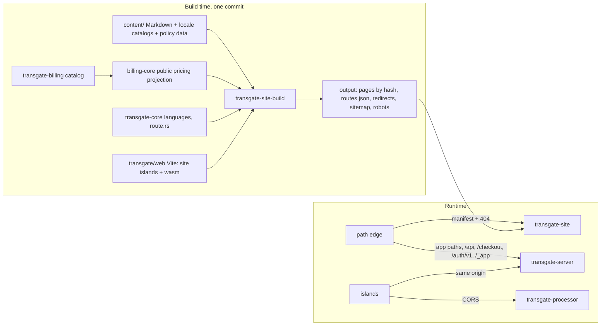

# P6 static site, blog and public tools: Opus proposal

2026-10-26. Independent design under `docs/plans/p6-static/brief.md`. I did not read the Sol proposal. No implementation, interface stubs, builds, tests, browser runs or provider calls. Source and rustr reads only. The counts below were computed read-only from the checked-in source snapshot (`frontend/public/sitemap-0.xml`, `frontend/public/articles`). They are evidence about files, not a build or crawl. Claims I could not observe are marked [INFERENCE].

## 0. Recommendation first

1. **Rust owns URL meaning.** A reusable `modules/cms/core` holds the URL, locale, indexing, sitemap, redirect and manifest model. Transgate's SEO policy, copied from `seoIndexing.ts` and `next-sitemap.config.js`, is data plus Rust functions in `transgate/site`, tested against the ledger rows SEO-001 to SEO-016. Whichever renderer E1 picks consumes those decisions. It never re-derives them.
2. **Generate one finite inventory eagerly, with no on-demand fallback.** Every URL the source answers with 200, 301 or 302 is enumerable from configuration: about 10.6k HTML pages [INFERENCE, exact number from the S0 manifest] plus a redirect table. Blocking fallback, `fallback: true` loading shells and ISR go away. An unknown path is a real 404.
3. **Keep the baseline as an exact, separate ledger.** All 4,527 sitemap URLs get a recorded disposition: 4,460 are P6 pages, 32 are P7 API docs, 15 are P5 app routes, 1 is sign-in, 16 are `/404`, 2 are prototypes and 1 is the voice test. Corrections SEO-D01 to D06 (plus P6-C01 to C10 below) are separate lead decisions with their own target count. The 4,527 gate is never silently lowered.
4. **Interactive tools are real presenters in the shared Rust core.** They render as Svelte islands built by the existing `transgate/web` Vite package. They talk to the existing P3 processor and the existing `/api/youtube/public-transcript` route, plus the browser capture APIs. There is no second media backend, and no Markdown stand-in for a tool.
5. **Public pricing comes from a new pure billing-core projection over the same `Catalog`.** It is evaluated at site build. It is not a second price table and not a new runtime pricing API.
6. **Routing topology.** The site image is a small Rust server (`transgate-site`) that serves the content-addressed output and the redirect table. A path edge in front sends app, API and auth paths to the existing app server. One P5 seam has to move: the app bundle prefix currently collides with the source's public `/assets/*` URLs (section 3.8).

## 1. Evidence read

- PRD sections 2 to 8. Discovery `static-pages.md` in full, plus the API, rules and parity rows for public captions and the processor.
- P3 decisions and contract (processor is P3-owned, pages are P5/P6). P5 decisions D3, D12, D13, D14 and D16, and the P5 contract.
- rustr code: `transgate/server/src/web.rs`, `transgate/core/src/presentation/route.rs`, `transgate/core/src/public_transcript.rs` and its host wiring, `transgate/processor` README and families, `modules/billing/core/src/pricing.rs`, the `/billing/catalog` route, `transgate/billing/src/catalog.rs`, `transgate/client/src/auth.rs` (`SESSION_KEY`), `transgate/client/src/attribution.rs`, `scripts/check-prd.py` `module_graph`, `transgate/web/{package.json,vite.config.ts}`, root `Cargo.toml` and the lock.
- Source, read only: `next.config.js`, `src/middleware.ts`, `next-sitemap.config.js` (exclude/transform 553-686), `src/config/seoIndexing.ts`, `components/SEO/KeywordPageIndexing.tsx`, `pages/languages/[slug].tsx`, `pages/translation/[...slug].tsx` 480-640, `pages/certification/[id].tsx`, `pages/blog/[[...articleSlug]].tsx`, `components/BlogPost/BlogPost.tsx` 75-130, `config/legacyBlogSlugRedirects.js`, `domain/packages.ts`, `LandingPage/{Pricing,PricingCard}`, `pages/index.tsx`, `Hero/VideoSection.tsx`, `PostHogProvider.tsx`, `_app.tsx`, `CookieConsent`, `legal/privacy-policy-en.tsx` (third-party claims), `ContactUS.tsx`, processor client utilities (`processorClient.ts`, `trimAudioServer.ts`, `useProcessorHealth.ts`, `clientZip.ts`), `TrimAudioTool.tsx`, `record-audio-online.tsx`, `tab-audio-capture.tsx`, `YouTubeTranscriptTool.tsx`.
- Owner fact (p1R): no public catalog projection with hours, expiry or locale-discounted display exists today. `/api/billing/catalog` exposes `PlanCard{name,interval,usd_per_month,struck_per_month,badge}` and `PaygCard{price_text,struck_per_hour}`. Locale totals are available only through the authenticated quote.

## 2. Scope: row families and the baseline

### 2.1 Baseline disposition (4,527 URLs, `sitemap-0.xml`)

Computed by locale-stripping every `<loc>`.

| Disposition | URLs | Content | Owner |
|---|---:|---|---|
| P6 page | 4,460 | blog 2,508 · features 705 · persona 336 · core 224 · tools 186 · free-tools 160 · how-to 128 · languages 112 · root keyword 38 · contact 32 · translation children 24 · legal 5 · certification 2 | P6 |
| API docs | 32 | `/api-docs`, `/api-reference` × 16 | P7 (D13). P6 gate counts them as P7-dependent dispositions, not as P6 renders |
| App routes | 15 | `/billing`, `/checkout`, `/checkout/confirm`, `/dashboard` + 7 children, `/home/all-transcripts`, `/home/all-transcripts/all-transcripts`, `/new-password`, `/new-signin` | P5 (P7 for key admin). `/home/all-transcripts/all-transcripts` matches no `route.rs` route, so the app answers 404 today |
| Sign-in | 1 | `/signin` | P5 page, a sitemap decision for P6 |
| `/404` | 16 | the error page as a URL | SEO-D03 |
| Prototypes | 2 | `/InvoiceForm`, `/NewBilling` | retired by P5 D14 |
| Voice test | 1 | `/voice-agent-test` | excluded by D6. No broadening |

These per-family sums reproduce discovery R5 exactly (blog 2,508 · languages 112 · translation 40 including 16 indexes · tools 186 · features 705 · free-tools 160 · legal 5 · certification 2 · contact 32). `<loc>` values are raw UTF-8 with entity escapes (`&apos;`), for example `/de/tools/app-für-spracherkennung`. There is no `lastmod` and no `xhtml:link`. The longest path segment is 168 bytes. Comparison normalizes entities, percent-encoding and trailing slash.

### 2.2 Render inventory is larger than the sitemap

Pruned pages still return 200 with `noindex, follow` and a cluster canonical (`seoIndexing.ts:1-14`). The P6 output must answer every source-served URL, not just the advertised ones.

| Family | Candidate space (source) | Behavior to preserve |
|---|---|---|
| Root keyword | 138 × 16 = 2,208 | 38 indexable, the rest noindex with cluster or editorial canonical (SEO-002 to 004) |
| Languages | 226 slugs × 16 = 3,616 | traffic paths indexable and self-canonical, others noindex with an English canonical. Today these are generated on demand (SEO-005, 006) |
| Translation | forward 51 × 2 (en, plus the target locale when it is a UI locale), reverse 56 × 2 (en), 16 keyword pages (en). Forward pages in a mismatched locale get a 302 to `/{locale}/translation` (`[...slug].tsx:618-628`; a second occurrence at `:719` to be captured by S0) | SEO-007, 008, D01, D05 |
| `/tools/{kw}` | 138 (de 84, tr 20, kk 34). Invalid locale or slug pairs get a 308 to `/` | SEO-009, D02 |
| Features, personas, core, how-to, free-tools, explicit tools, contact | about 16 locales each | per-page head and schema |
| Certification | 3 known ids (evan, bisan, fawwaz) × 16. Any other id renders "Certification not found" with 200 | P6-C01 |
| Blog | 16 indexes plus every (article, locale) with metadata. Cross-locale slugs get a 301 to the locale slug. 27 legacy 301s (`legacyBlogSlugRedirects.js`) | SEO-010 to 012, 015, D06 |

Blog facts measured from `public/articles`: 2,538 `.md` files in 159 directories, including one stray `2025-02-26/.md`. Nine files have no `<+++>` metadata, so their locale is a 404. Four same-locale slug collisions cross directories:

- de, sv and tr between `2025-01-09` and `2025-02-16`
- fr `api-de-reconnaissance-vocale` between `2025-07-01` and `2025-07-02`

65 slugs are reused across locales (legitimate, because the URL prefix differs). Every filename matches its `Language:` value. No article contains raw HTML tags (`div`, `iframe`, `script`, `img`). `BlogPost.tsx` sets `datePublished` to the raw directory name, so `2025-04-31` is emitted as-is.

### 2.3 Public surfaces that are not plain pages

- **Seven processor families** (trim × 3 routes, convert-audio, reduce-audio, remove-noise, video-to-audio, compress-video, convert-video): 10 free-tools routes × 16 locales. `CLIENT_WASM_ENABLED = false`. The `*Client.ts` ffmpeg.wasm path is dormant and stays out of scope.
- **Public captions:** `/tools/youtube-transcript-generator` calls the anonymous same-origin `POST /api/youtube/public-transcript`. It is already implemented in `transgate/http` (`public_transcript`, rate limiter, six-hour cache in `transgate_core::public_transcript`). The base URL for the public YouTube transport is configurable (`settings.youtube_public_base`).
- **Recorder** (`getUserMedia`, `enumerateDevices`, `devicechange`, MediaRecorder MIME order webm/ogg/mp4/wav at 128 kbps, WAV conversion via `decodeAudioData`) and **tab capture** (`getDisplayMedia`, WAV download that falls back to the original format if conversion fails, Chrome/Edge-only copy, phone permission and unsupported outcomes). There is no job and no debit (UPL-032).
- **Contact form:** a real `POST /api/contact-us` (EML-007, API-F36) followed by navigation to `contact/success`. This backend does not exist in rustr today (no match in `transgate/http` or `transgate/server`). It is a P6 host dependency, not a placeholder.
- **Home signed-in redirect:** the source middleware redirects `/` to `/{locale}/home` when any `sb-*-auth-token` cookie is present, unverified. `index.tsx` also does `router.push("/home")` when `user` is set. P5 D13 replaces both with a verified probe (section 3.11).
- **Landing explainer:** `VideoSection.tsx` mounts two `youtube-nocookie.com/embed/*` iframes, one per breakpoint and hidden by CSS, on page load with no consent gate. The caption result loads `i.ytimg.com` thumbnails.

## 3. Architecture

### 3.1 Crates and packages

| Path | Kind | Contents | Dependencies |
|---|---|---|---|
| `modules/cms/core` (`cms-core`) | pure lib | `Site{origin, locales, default_locale}`, `PagePath` (locale + decoded segments, exact bytes), URL formatting (default unprefixed, `/en/...` accepted as an alias), `Indexing{robots, canonical, alternates, x_default}`, `Redirect{from, to, status, locale_exact}`, `SitemapEntry{loc, changefreq, priority}`, the sitemap writer (split at a configurable size, index file), the robots writer, `Manifest` and its diff (`missing`, `extra`, `changed{status, robots, canonical, alternates, sitemap}`), an HTML/attribute/JSON-in-script escaping module, a Markdown article model and importer-agnostic front matter | `serde`, `serde_json`, `percent-encoding` (all in the lock). No I/O |
| `modules/cms/http` (`cms-http`) | lib | Axum router over a built output: an exact manifest lookup (`HashMap<decoded path, (file hash, content type, status)>`), the redirect table, a localized 404 page with status 404, GET/HEAD only, ETag from the content hash, `no-cache` for HTML and immutable caching for hashed assets, plus an injection hook for one config marker | `axum`, `tower-http` (in the lock) |
| `crates/taskr-site` | taskr consumer | 2 locales, one static page, one blog post, sitemap and hreflang. Satisfies `check-prd.py` `module_graph` (every `crates/taskr-*` and `transgate/*` host must reach `modules/cms`) and PRD scenario 12 | `cms-core`, `cms-http` |
| `transgate/site` (`transgate-site`) | Transgate host | `content/` (blog Markdown, imported page catalogs, legal text, asset manifest), `policy/` (ported indexing tables: `INDEXABLE_KEYWORD_PAGES`, `CLUSTER_CANONICAL`, `EDITORIAL_CLUSTER_CANONICAL`, `KEYWORD_PAGE_LOCALE`, `INDEXABLE_TRANSLATION_KEYWORDS`, the 359-entry `TRAFFIC_EARNING_PATHS`, the priority and changefreq rules), `templates/`, two binaries: `transgate-site-build` and `transgate-site` (the server) | `cms-core`, `cms-http`, `transgate-core` (languages, route), `billing-core` plus `transgate-billing` (catalog), the renderer chosen by E1 |

`modules/cms` depends on no billing and no Transgate crate. Pricing enters `transgate/site` only. This keeps the module splittable (PRD section 5). The module has no `postgres` crate, because content lives in git; that follows the module rules, which require a schema only where data exists.

### 3.2 Content model and import

- **Blog:** one directory per source date, one Markdown file per locale. Source `<+++>` metadata becomes explicit front matter: `id` (the directory name), `locale`, `slug`, `title` (1), `description` (2), `long_description` (3), `faq[]`, `author{name,url}`, `genre`, `published` (normalized ISO date), `published_raw` (the directory name), `modified`. The body is unchanged.
  - A one-shot importer (`scripts/p6-content`, kept with its tests until cutover, then deleted) writes these files.
  - The importer also emits a differential: for every source file, the parsed metadata the source parser produces (`getMetaValue` regexes, `parseLocale`) against the imported front matter. Quirks such as substring locale matching and the `Author URL` default are frozen into data, never reimplemented at build.
  - Files with no metadata stay out of the published set, recorded with their source path. The stray `.md` is recorded and dropped.
- **Page copy:** the source page copy lives in i18next namespaces (`public/locales/{16}/{common,cs,kw,howto,tools,languages,translation*,seo-keyword-pages,…}.json`, 35 MB in total) plus TSX literals (legal pages are inline English and Turkish JSX).
  - The JSON namespaces are imported verbatim into `transgate/web/locales/{locale}/site-*.json` with provenance through the P5 locale pipeline contract (D3: P6 namespaces are P6's). The renderer and the islands then share one catalog.
  - TSX literals move into template-local content files, with a provenance column per string.
  - The source uses English sentences as keys, so a missing translation renders the English key. P6 preserves the rendered text and lists each fallback in `site-fallback-manifest.json`. Translating those gaps is a separate decision (DP-11).
- **Data-driven pages:** `supported-languages` and the language matrix read `transgate_core::languages`, the generated single authority (PRD 7.4), not copied lists. A test asserts that the source `config/languages.ts` slugs match.
- **Assets:** everything under `public/` is copied at the same URL. A SHA-256 manifest records each file and the routes that reference it. Unreferenced files are kept at their URL, because external links and Google Images may point at them. Explicit exclusions:
  - `demo-voices/` (voice demo, D6)
  - `openapi/` (P7 decides)
  - `sitemap*.xml` and `robots.txt` (regenerated)
  - The dormant WASM helpers, if only the disabled client path references them [verify per file]

### 3.3 URL, locale and slug rules

- Locales: en (unprefixed), tr, pt, es, de, id, it, fr, el, ru, da, sv, no, fi, kk, az (SEO-001, `next.config.js:21-24`). One table in `cms-core::Site`. Transgate supplies it from `transgate_core::languages::UI_LOCALES`.
- Slugs are opaque, decoded UTF-8 byte sequences, compared exactly. No Unicode normalization and no case folding, because the source does neither. The request path is percent-decoded once, and an invalid escape is a 404.
- Output is content-addressed (`pages/<sha256>.html`) and indexed by `routes.json`. The filesystem never holds slug-derived names, which removes the risks from path-length, Unicode and case-insensitive filesystems.
- Trailing slash, an explicit `/en/` prefix and the `/en/blog/...` cross-locale redirect target follow observed source behavior from the oracle (S0). Where Next.js defaults are the only evidence, I mark them [INFERENCE] and the oracle decides: trailing slash 308 to the stripped path; `/en/x` serves `x` with an unprefixed canonical.
- Sitemap `<loc>` and canonical/hreflang hrefs are produced by one formatter. P6-C02 decides whether non-ASCII is percent-encoded.

### 3.4 Head, structured data and escaping

- Exactly one robots meta per page. The source `_app.tsx` default `index, follow, max-image-preview:large, max-snippet:-1, max-video-preview:-1` is overridden per family exactly as the policy decides.
- Canonical and alternates come from `Indexing`. Per-page alternates are reproduced only where the source emits them, for example `pricing.tsx` emits 16 locales plus `x-default`, while indexable keyword pages emit only their own locale.
- JSON-LD stays page-specific: home Article/Organization, blog Article plus FAQPage, feature/how-to/translation HowTo/SoftwareApplication/FAQ, and the contact schema. Values are captured from the oracle and compared as parsed JSON, never invented. Open Graph and Twitter tags follow per family (`og:locale` via the `en_US` translation key).
- Escaping:
  - HTML text and attributes are auto-escaped by the template engine.
  - JSON-LD and config blocks are serialized with `<`, `>`, `&`, U+2028 and U+2029 escaped. This is the same rule as `web.rs` `ScriptFormatter`, reimplemented in `cms-core` because a module cannot depend on `transgate-server`.
  - Markdown renders with raw HTML escaped. Sources contain none, so this is a no-op guard, not a content change.
  - Catalog strings render as text unless the oracle shows that the source rendered markup (`Trans` or `dangerouslySetInnerHTML`). Those keys are allow-listed with their exact tags.
- Links: the build fails on an internal `href` that resolves to neither a manifest page, a redirect, an app route (`is_app_path`), `/api/*` nor an asset. External links keep the source `rel` and `target`.

### 3.5 Static generation versus runtime routing

| Source mechanism | P6 | Observable difference |
|---|---|---|
| `getStaticProps` pages × 16 | eager pages | none |
| `languages/[slug]`, blocking fallback, `revalidate: 3600` | eager 3,616 pages; the generated set is the configured slugs | SEO-D04: an unknown slug is a 404 instead of silently rendering the English-audio default |
| `translation/[...slug]` blocking fallback | eager paths plus a redirect-table row for each mismatched forward locale (302) | none for configured paths. Unknown paths are a 404, as the source `notFound` already is |
| `certification/[id]` `fallback: true` | eager 3 × 16 | P6-C01: an unknown id is a 404 instead of a "Certification not found" 200 |
| Blog `fallback: true`, ISR one year | eager, publication filter `date <= build time` | A future-dated post appears at the next build or deploy, not on its date by direct URL. The source index is cached for a year, so on this point the source is already inconsistent. No post is future-dated today (the newest directory is `2026-07-06`) |
| Next redirects (legacy blog), `/tools` invalid pair to `/` (308), blog cross-locale (301), translation locale mismatch (302) | one redirect table built from data | none. Each row records its source line |
| Middleware cookie redirect at `/` | verified probe island (3.11) | P5 D13 correction, already decided |

The site server knows only the manifest. It has no fallback rendering, no templates at runtime and no blanket 200.

### 3.6 Sitemap and robots

- Sitemap entries are exactly the policy's `indexable ∧ advertised` set: URL-normalized, deduplicated, `weekly`, priority 0.7, transcription and keyword translation 0.9, forward translation 0.8 (SEO-014).
- The file names `sitemap.xml` (index) and `sitemap-0.xml` are kept, with the split at 7,000 (SEO-013).
- `robots.txt` content is identical to the source (SEO-016).
- The baseline profile (4,527) and the corrected target (after decisions) are two named, checked-in manifests. The gate checks the selected one and reports its delta against the baseline line by line.

### 3.7 Renderer and E1

E1 (PRD section 4) remains the decider. It should run on the S0 manifest: pricing, one SEO landing page and one blog post in 2 locales, expanded through the manifest to the full render inventory count, so that "builds the full page count in under 2 minutes" is measured against the real number.

My prediction, recorded so the experiment can disprove it: **a Rust generator** (Askama 0.16.1 is already in `Cargo.lock`, though only transitively through `uniffi_bindgen`, plus a new `pulldown-cmark`) wins on fewest moving parts.

- SEO decisions and pricing are already Rust functions, so templates call them directly.
- Tailwind v4 scans the template files from the same `tokens.css` import the web package uses.
- There is no second JavaScript framework: islands stay Svelte.
- SvelteKit prerender would add `@sveltejs/kit` to a plain-Vite P5 package and would need the Rust policy exported as JSON or wasm.
- Astro fails the tie rule.

Whatever wins, `cms-core`, `policy/`, the manifest, the server, the islands and the gates stay unchanged. Only `templates/` and the build glue change.

Markdown parity is a separate risk regardless of the renderer. The source uses markdown-it into a custom AST (`domain/blog.ts:366-624`) that React components render. The port converts pulldown-cmark events into the same AST node kinds, and a differential over every published (article, locale) compares node sequences and text against the source parser run under Node (acceptance G2).

### 3.8 Packaging and routing topology

- **Site image:** a build stage (pinned Rust image plus the D16 Node image for `npm ci` in `transgate/web`) runs `transgate-site-build`. The runtime stage is `debian:bookworm-slim` running as non-root with `transgate-site`, the output directory and `HEALTHCHECK /health`, the same pattern as `transgate/Dockerfile`.
- **Edge:** a pinned Caddy image, as `transgate/processor/deploy/caddy.Dockerfile` already does. It routes by a generated matcher:
  - to the app: `/api/*`, `/auth/v1/*`, `/checkout`, `/checkout/confirm`, every `route.rs` app route under every locale prefix, and the app bundle prefix
  - everything else to the site
  - A Rust test generates the matcher from `transgate_core::presentation::route` and the manifest, and asserts the two sets are disjoint and the union is complete for the manifest plus app routes. The edge is a deployment artifact. Production DNS, TLS and trusted-proxy counts belong to P9.
- **Collision that must be resolved before integration:** `web.rs` serves the Vite bundle at `/assets/{*path}` and `/theme-init.js`. The source public site serves blog images, `og:image` (`/assets/homepageThumbnail.jpg`), certificates and logos under `/assets/*`, and those URLs are externally linked. Request to the P5 host and web owners: move the app bundle to `/_app/*` (Vite `build.assetsDir` plus the `web.rs` route plus CSP), one cutover with no alias. The site owns `/assets/*` and serves its own copy of the generated `theme-init.js` at a site path.
- **Rejected alternatives:**
  - The site server reverse-proxying to the app: adds SSE, upload and `X-Forwarded-For` risk to new code.
  - Folding the site output into the app image: fewer moving parts, but contradicts the PRD packaging decision ("static site as a second image"). mu could choose it explicitly.
- **Runtime config:** HTML files carry one marker. `transgate-site` injects one `application/json` config block (processor origin, PostHog/Sentry public keys, environment), reusing the P5 `PublicConfig` field names. Islands read it. A `TRANSGATE_SITE_*` environment value missing at startup fails fast, as `web.rs` `settings_from` does.
- **CSP:**
  - `script-src 'self'`
  - `connect-src 'self'` plus the processor origin plus consented telemetry hosts
  - `img-src 'self' https://i.ytimg.com`
  - `frame-src https://www.youtube-nocookie.com`
  - `media-src blob:`
  - JSON-LD blocks are inert data, not scripts.

### 3.9 Public pricing seam (billing owner)

A new pure function in `modules/billing/core`, `presentation::public_pricing(catalog: &Catalog, ui_locale: &str) -> PublicPricingView`, returns the three landing cards: PAY AS YOU GO, PREMIUM, BUSINESS. Each card has its monthly and yearly state, `price`, `struck`, a `per` unit (hour or month), hours per package, expiry (months or the One YEAR text key) and the catalog label key. It matches `PricingCard.tsx:29-130` and `domain/packages.ts:69-89`:

- Monthly 14/21. Yearly 120/12 = 10 and 180/12 = 15. Struck 40/60/30/55/2.
- PAYG 1.49, or `floor((1.49 - 1.49 × 0.5) × 100) / 100 = 0.74` for id and pt, using the existing `locale_discount_locales` and `Floor` rule from `payg_display_total`.
- Hours 20/40. "/ hour" exactly when the package is 60 minutes.
- Amounts render the way JavaScript `Number.toString` renders them (`14`, not `14.00`). That formatting lives in the billing presentation, not in a template.

This is the landing-card rule. It deliberately differs from the purchase modal's CPN-015 cards (badge, TL line), and both exist in the source. There is no HTTP route and no money arithmetic in the site.

Because the site build and the app link the same `transgate-billing::catalog()` at one commit, there is one authority. The build records a catalog digest in the output. The packaged gate compares it with the app built from the same commit, and P9 keeps both images on one release tag.

`PriceCountdown` ended on 2025-09-30 and renders nothing (billing discovery line 92), so it is not ported. The free-trial line, Iyzico logo, API section links (to the P7 docs URLs) and the sign-in CTA are ported as page content.

### 3.10 Interactive tools

**Core** (pure, `transgate/core/src/presentation/tools/`, owned by the core module-declaration owner): one reducer per surface. Each follows the P5 pattern `update(event) -> effects`, `view() -> Vm` with message keys.

- **`ProcessorTool{family}`** covers all seven families through a family descriptor (options form, action path, result fields, one or two outputs, thumbnail):
  - `Idle → Picked → Uploading → Uploaded(session, probe) → Configuring → Processing{percent} → Done(outputs) | Failed(kind)` with reset and invalidate.
  - Polls every 1,500 ms. Percent is capped at 99 until done. `failed` and `expired` end the poll, with the source expiry message.
  - Control requests time out at 10 s; uploads, process requests and downloads at 30 min.
  - Error kinds: overloaded (503 with a `Retry-After` countdown), rate-limited (429), server error, timeout (transferring or not), network. The source mapping is in `useProcessorHealth.ts:33-149`.
  - Trim downloads both parts as blobs, and its ZIP action builds the archive client-side (`ClientDownloadSection.tsx:138`, `clientZip.ts`). The server's `/trim-audio/download-zip` stays P3 API parity, with no mounted browser caller. Recorded, not changed.
  - Product rules already in `transgate_core::tools` (formats, limits, options validation) are reused for pre-submit checks only where the source client checks them too. The S0 inventory of client checks decides which; the server remains authoritative.
- **`Recorder`:** idle, recording, paused, recorded; device list and changes; MIME preference order; WAV conversion and download name.
- **`TabCapture`:** unsupported, permission denied, no audio track, recording, recorded; WAV conversion with the original-format fallback; the recovery prompt (`RecoveryPrompt.tsx`) as the source behaves [owner to capture its storage mechanism].
- **`PublicCaptions`:** URL, format and language input. Maps the API-020 and API-021 statuses. Copy, download as `{videoId}-transcript.{ext}`, signup CTA on no-transcript. Formatting reuses `public_transcript` formatters, so there is no TypeScript formatter.

**Wire DTOs:** `transgate/api::tools` holds typed decoders for the processor JSON. The processor keeps its accepted `json!` responses unchanged, so P3 evidence (artifact 400) is not disturbed. A contract test decodes every response of the existing processor acceptance harness with these DTOs.

**wasm (client owner):** exports the four presenters. Browser ports, with media kept in `File`/`Blob` handles (never copied through wasm):

- `fetch` with AbortController, `FormData` upload, blob download
- object URLs, `navigator.clipboard`
- `getUserMedia`, `enumerateDevices`, `MediaRecorder.isTypeSupported`, `getDisplayMedia`
- `AudioContext.decodeAudioData` plus WAV encoding in a TypeScript platform adapter. A Rust encoder would copy whole PCM buffers into wasm memory.
- The client ZIP writer: a new pinned `client-zip` dependency, which the source uses (`^2.4.5`)

**Web (UI owner):** `transgate/web/src/lib/features/public-tools/{views/desktop,views/mobile}` follows the existing conventions: pure views, stories from Rust fixtures, component tests on both platforms. A second Vite build emits island entries (`site-shell`, `tool-<family>`, `recorder`, `tab-capture`, `captions`) into `dist-site/`, which `transgate-site-build` copies with hashes.

Static pages are one responsive template per URL rather than separate desktop and phone DOM trees. Duplicated content in one HTML document would hurt SEO, and the source public pages are responsive (`md:hidden`). This is a recorded exception to the "desktop and phone view per screen" convention for non-interactive content only (DP-10).

### 3.11 Session hint, consent, third parties

- **Home probe** (on all 16 locale roots, matching the source middleware scope):
  - If `localStorage["transgate.session"]` (`SESSION_KEY`, documented in `client/src/auth.rs:27` as "the presence hint P6 reads") is present, lazily load a wasm `session_probe(locale)` exported by the client owner. It reuses the existing restore, refresh and lock code and `GET /api/session`.
  - Navigate with `location.replace("/{locale}/home")` only on a verified profile. Expired, invalid, storage-blocked or network failure leaves the visitor on the page, and the probe never clears app storage. That makes a loop impossible: the app never redirects to `/` for an unverified session.
  - Anonymous visitors load no wasm.
- **Consent and telemetry:** the `site-shell` island reuses the P5 consent component and `telemetry.svelte.ts`, so PostHog and Sentry initialize only after consent (D12). GA (`G-RYSYW8PX04`), Hotjar and New Relic, which the source `_app.tsx` and `_document.tsx` load on public pages, are omitted with the same D12 provenance. The lead should confirm D12 extends to public pages (DP-08).
  - Source parity details to keep or explicitly decide: the source skips PostHog for locale `id`, and captures UTM data (`captureUTM`) in PostHog `loaded` independent of consent.
  - UTM capture reuses `transgate_client::attribution` (same storage key `transgate_utm_data`), loaded lazily only when the URL carries `utm_*`. `sendGTMEvent` on home is dropped (GTM is commented out in the source).
- **Third-party contact, stated honestly:**
  - The landing explainer iframes contact YouTube on page load. Source parity keeps them, with one iframe mounted per viewport only if P6-C04 is approved.
  - Caption results load `i.ytimg.com` thumbnails.
  - The processor is a separate origin.
  - Neither of the first two is consent-gated. The current privacy policy says third-party YouTube cookies apply "when you interact with embedded YouTube videos" and lists Google Analytics and Supabase. P6 must not publish privacy copy that is wrong about the new behavior. That is a legal text decision for mu (P6-C07). No silent edit.

### 3.12 Design, accessibility, devices

- Generated root tokens (Paper Moss default), light, dark and system theme via the shared `theme-init.js`, and the P5 UI primitives inside islands.
- Static pages keep the source section order, copy, links and CTAs (for example the home order in `index.tsx:180-234`, with the voice demo and newsletter already commented out in the source). They are restyled only through tokens. Any creative change goes behind an off-by-default flag listed in the milestone note (PRD section 2).
- Keyboard and focus: skip link, visible focus, menus and dialogs from P5 primitives, tool controls operable without a pointer (trim point input as well as the waveform), `aria-live` progress.
- `lang` and `dir` are set per locale; none of the 16 UI locales is RTL.
- The landscape notice (`LandscapeBlocker`) mounts on public pages in the source and should reuse the P5 one.

## 4. Exact shared seams

| Seam | Owner | What P6 needs | Status |
|---|---|---|---|
| App bundle prefix moves off `/assets/*` | P5 host (web.rs) and web package (Vite) | `/_app/*` or another non-manifest prefix, CSP updated, one cutover | new request |
| `public_pricing(catalog, locale)` | billing core | the pure view in 3.9 plus tests against the source card values for en, id, pt, tr | new, confirmed absent (p1R) |
| `session_probe(locale)` wasm export | client/wasm | verified/not-verified result using existing restore and refresh code, no storage mutation on failure | new |
| Attribution capture export | client/wasm | the existing `attribution::capture`, callable from a site island | reuse |
| Tool presenters and DTOs | core + api + wasm | section 3.10 | new |
| Processor | P3 | unchanged routes, CORS allow-list includes the site origin, one instance (OPS-D06) | exists |
| `/api/youtube/public-transcript` | P3 host | unchanged; the edge must preserve the client IP for RTL-004 (`client_ip`, trusted-proxy count) | exists |
| `/api/contact-us` with mail and acknowledgement (EML-007, API-F36) | host + mail | public POST, same two mails, no captcha (none in the source) | missing, required before the contact rows close |
| P5 consent, telemetry, theme, primitives, i18next, locale pipeline | P5 owners | reused by islands; P6 namespaces added through the D3 pipeline | exists or in flight |
| `/api-docs`, `/api-reference` (32 baseline URLs), `openapi/` assets, pricing-page API links | P7 | served at the same URLs by P7, or an explicit P7 correction | P7 |
| `/signin` and the other app routes in the baseline | P5 | served by the app; the sitemap decision is P6's (D03) | exists |
| Edge, DNS, TLS, trusted proxies, processor origin, live Search Console, staging Lighthouse | P9 | deployment of the generated matcher and images | P9 |
| Module gate | lead | `modules/cms/core` named `cms-core`, consumed by `taskr-site` and `transgate-site` | gate exists |

## 5. Decisions: source parity versus corrections

Every correction changes an observable result, so each is listed with its count effect. **Parity is the default wherever no row is approved.**

| ID | Current | Recommendation | Count effect |
|---|---|---|---|
| SEO-D01 | 11 of 16 translation keyword paths are in the sitemap but render noindex | Drop the 11 from the sitemap; keep the pages | −11 |
| SEO-D02 | 138 `/tools/{kw}` URLs are in the sitemap but render noindex with a root-cluster canonical | Make the page consistent with the sitemap. My pick: noindex and drop from the sitemap, except paths in `TRAFFIC_EARNING_PATHS`, which become self-canonical and indexable (the SEO-002 philosophy). mu decides | −(138 − traffic hits) |
| SEO-D03 | The sitemap includes `/404` × 16, 15 app routes, 2 prototypes and the voice test | Drop those 34; keep `/signin` and the P7 docs | −34 |
| SEO-D04 | An unknown language slug renders the English default | 404 | none in the sitemap |
| SEO-D05 | Forward translation hreflang names source languages that are not UI locales | Emit only alternates that resolve to a generated 200 page; keep the English canonical (traffic) | none |
| SEO-D06 | 4 slug collisions, 9 metadata-less files, a stray file, `2025-04-31/32/33` directories | The identity is (directory, locale); URLs are kept. In each collision the oracle-observed winner keeps the URL. mu chooses whether the loser gets a new suffixed slug (+1 URL each) or stays unreachable (parity). Malformed directories keep their id; the normalized date drives sort, publication and JSON-LD | 0 to +4 |
| P6-C01 | Unknown certificate id: "not found" page with 200 | 404 | none |
| P6-C02 | Raw UTF-8 in `<loc>` | Percent-encode per the sitemap protocol; the manifest compares decoded | none |
| P6-C03 | `datePublished: "2025-04-31"` | Emit the normalized ISO date | none |
| P6-C04 | Two explainer iframes load, one hidden | Mount one per viewport (fewer third-party requests); otherwise parity | none |
| P6-C05 | Unverified cookie redirect at `/` | Verified probe (P5 D13, already decided) | none |
| P6-C06 | Trailing slash and `/en/` alias behavior | Follow the oracle; record any deviation | none |
| P6-C07 | Privacy policy names GA, Supabase and "interact with" YouTube | mu-approved legal copy before publication; P6 does not edit legal text itself | none |
| P6-C08 | Blog publication at request time (ISR) | At build time; a scheduled post needs a rebuild | none today |
| P6-C09 | `Loading...` fallback shells for crawlers | Gone (eager) | none |
| P6-C10 | Deploy-time catalog drift is possible between images | Same-commit images plus a digest check | none |
| DP-08 | GA, Hotjar and NR on public pages | Extend D12 omission to public pages | none |
| DP-10 | Desktop/phone view convention | Responsive single template for static content; islands keep both views | none |
| DP-11 | English fallback keys in localized pages | Preserve with a manifest (parity); translating is a separate scope decision | none |

The **target manifest** is the baseline plus the approved rows, written as a second checked-in profile. The PRD P6 "page count equals today's sitemap" gate passes only when one of these holds:

1. The 4,527 profile reconciles with zero unexplained differences.
2. mu approves the corrected profile, and every removed or added line references its decision ID.

## 6. Ownership and order

One writer per file. Root Cargo, lock and Docker stay with the integration owner. These are suggested slices, and the lead assigns sessions.

| Order | Slice | Owner type | Output |
|---|---|---|---|
| S0 | Source oracle and manifests | integration/testing owner, after lead authorization | `transgate/site/manifest/{baseline.tsv, render.tsv, head/*.json}` with the source sitemap SHA-256; source oracle run log |
| S1 | `modules/cms/{core,http}`, `crates/taskr-site` | CMS owner | module plus taskr slice and their own tests |
| S1 | `public_pricing` | billing owner | pure view plus tests |
| S1 | Tool presenters (core), DTOs (api), wasm exports including `session_probe` | core, api and client owners | reducers, fixtures, exports |
| S2 | Content importer, blog normalization, catalogs, legal, assets | content owner (locale pipeline owner) | `transgate/site/content`, differential reports |
| S2 | SEO policy port | CMS or site owner | `policy/` plus SEO-001 to 016 Rust tests |
| S3 | Templates for every family, plus E1 spikes | site owner; E1 executed by the testing owner | templates; E1 verdict record |
| S3 | Islands and views | web/UI owner | desktop and phone views, stories, component tests |
| S4 | `transgate-site` server, app prefix cutover, edge matcher, site Docker | site owner + P5 host/web owners + integration owner | images and compose |
| S4 | `/api/contact-us` | host + mail owner | route, mails, tests |
| S5 | Acceptance | testing owner | gates below |

S0 comes first, because the manifests are the contract every other slice checks against. S1 slices run in parallel. Templates wait for S0 and the policy port. The packaged gate waits for P5's prefix cutover.

## 7. Acceptance plan (executed by the independent testing agent after lead authorization)

The scripts and tests are named; this proposal does not author them.

- **G0 Source oracle:**
  - Run the source site from a temporary copy (never the source repository) with locked dependencies, no secrets and outbound network off at runtime. Crawl the render candidate space.
  - Record for each URL: status, redirect target, robots, canonical, alternates, `<html lang>`, title, description, JSON-LD (parsed), visible text and link lists.
  - If the source cannot build without secrets, the fallback is evaluating the source configuration and head functions under Node (as R5 did for the sitemap). The report must say which evidence class each family received.
- **G1 URL reconciliation:** `cms-core` manifest diff, generated output against `baseline.tsv` (sitemap) and `render.tsv` (all served URLs):
  - zero missing or extra entries
  - zero changed status, robots, canonical, alternates or sitemap membership, except rows naming an approved decision ID
  - per-locale sitemap counts matching SEO-L01 to L16 (baseline profile) or the approved target
- **G2 Content parity:**
  - The blog AST differential over every published (article, locale), source markdown-it against the Rust converter.
  - Per-page normalized visible text and link sets against the oracle, for every page in families with fewer than 100 URLs, and all pages of every template family by hash of the template inputs.
  - Locale fallback manifest diff.
- **G3 Head and structured data:**
  - JSON-LD parses and equals the oracle (except P6-C03).
  - Canonical targets resolve to manifest 200 pages.
  - hreflang alternates resolve and are reciprocal where the source emitted reciprocal sets; `x-default` is present where the source had it.
  - One robots meta per page. Valid BCP 47 codes.
- **G4 Lighthouse SEO 100** (pinned Lighthouse plus Playwright Chromium, desktop and mobile emulation), on indexable samples only, because `noindex` correctly fails Lighthouse's crawlable audit:
  - `/`, `/tr`, `/pricing`, `/de/pricing`, `/blog`, `/kk/blog`
  - one en and one el article
  - `/features`, one feature child
  - one traffic language page, one forward translation (en), one indexable keyword page (es)
  - `/tools/youtube-transcript-generator`, `/free-tools/trim-audio`, `/fr/contact`
  - Plus axe accessibility on the same set.
- **G5 Real tool flows** (Playwright on the desktop and phone projects, against the real `transgate-processor` with FFmpeg and tiny generated fixtures):
  - All seven families: upload, options, progress, done, downloaded bytes probed by ffprobe. Trim produces two parts plus a client ZIP.
  - Failure paths: 409 already processing, 429 allowance, 503 with `Retry-After` countdown, expired session, processor down.
  - Captions against the real Axum route with a loopback YouTube fixture through `youtube_public_base`: txt, timestamped, srt and vtt, 400, 404, 422, 429 and 502 outcomes, copy and download, no-caption CTA.
  - Recorder with Chromium fake media devices.
  - Tab capture where Chromium automation can grant display media; otherwise a recorded manual desktop run. The phone project must show the source unsupported or permission outcome, and no native capture claim [INFERENCE: automation capability to be proved by the testing owner].
- **G6 Packaged routing** (compose: edge, site, app, PostgreSQL, GoTrue, processor):
  - A crawl through the edge reproduces G1 statuses.
  - App routes and `/api` reach the app; `/assets/*` reaches the site; `/_app/*` reaches the app.
  - Home probe: no hint stays; valid session lands on `/{locale}/home`; expired or invalid stays without a loop; storage blocked stays.
  - Contact form sends both mails to a loopback mailer. Health checks pass, non-root, no runtime downloads.
- **G7 Pricing:**
  - Rendered card values equal `public_pricing` for all 16 locales.
  - id and pt show 0.74.
  - The catalog digest equals the app's from the same commit.
- **G8 UX:**
  - Keyboard-only traversal of the sample pages and every tool.
  - Light, dark and system themes.
  - 320 px phone and landscape notice.
  - Long Kazakh and Greek slugs and titles.
  - Screenshots recorded.
- **G9 Privacy network log:**
  - No telemetry request before consent.
  - Documented YouTube contact on home and in caption results only.
  - No contact with any host absent from the CSP.
- **Ledger:** SEO-001 to 016 (Rust), SEO-P001 to P034 and SEO-L01 to L16 (Playwright and manifest), WEB-BIL-030 and 031 (pricing), API-F36 and EML-P009/P010 (contact). Rows for API-F17 and the processor already belong to P3 and are referenced, not duplicated.

## 8. Risks and questions for the lead

1. The `/assets/*` collision blocks packaged integration until P5 moves the app prefix (section 3.8). I recommend deciding this now, while P5 is still in flight.
2. The source oracle may need a source build environment. If it cannot run, head parity for families not covered by configuration evaluation is weaker evidence, and the report must say so rather than pass.
3. The 35 MB of catalogs plus TSX literals is the largest content effort, and translation gaps (DP-11) could become a large scope expansion if approved.
4. The PRD's "static site as a second image" forces an edge. Folding the site into the app image is simpler, if mu prefers it.
5. The legal copy (P6-C07) is mu's text. Publication of the privacy page waits for it.
6. P7 owns 32 baseline URLs. The baseline-profile gate cannot be green before P7 serves them or records its own correction.
