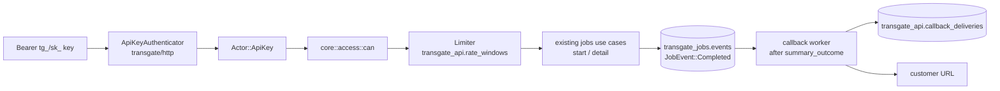

# P7 public API proposal (Fable)

Advisor `w23:p27`, anthropic/claude-fable-5-1, MEDIUM, 2026-10-26. Independent; the Opus proposal was not read. Read-only evidence: PRD §2-8 and P7 row; `transgate/docs/discovery/api.md` (all rows), `billing.md` API/deferred rows, `production-facts.md` R3; P5 D5/D7; current `transgate/{api,http,core}` seams and source files cited inline. No builds, tests, stubs or source writes. Proposed names are proposals, not existing symbols.

## 0. Position

P7 is small and mostly already shaped by earlier phases. `transgate-api` already parses the v1 request (`Transcriptions::{JobIds,AudioUrls}`, `lib.rs:108-194`), core already starts URL jobs with SSRF checks and stores `callback_url` (`jobs/app.rs:726-758`, `domain.rs:272`), the completion outbox already exists (`JobEvent::Completed`, `ports.rs:196`, `store.rs:48 claim_events` with lease) and P4 already ordered `summary_outcome` before callback assembly. What P7 adds: an API-key authenticator producing an `Actor`, a pure `can()` in core, a Postgres limiter, a callback dispatcher consuming the existing outbox with delivery records and replay, idempotent public starts, key management use cases plus the two P5-deferred views, and OpenAPI emitted from the existing `transgate-api` types. No new crate group; one `api` module in core, one schema prefix `transgate_api`, routes in `transgate/http`.

## 1. Row inventory

### 1.1 P7 must make green

| Rows | Family | Note |
|---|---|---|
| API-F01, API-F02 | `POST/GET /api/v1/transcriptions` under API key | Rules API-001, 007-010; currently unmounted (`http/src/lib.rs:9-11`) |
| API-F03, API-F04 | v1-beta shim | Rules API-011-013, D05. **Mounted only if mu chooses the shim** (production-facts R3: 2 live owners, version unknown). Otherwise `dropped` with mu record |
| API-F05 | `/api/unified/transcriptions` 301 | API-014; trivial, keep |
| API-F06 | legacy browser `/api/transcripts` | P5 D5 moved browser start to `/api/jobs/start`; needs a `dropped` record, not a route |
| API-F07, API-F08, API-F09 | key list; create/copy/list/revoke desktop and phone | API-002-006, 019; WEB-045/046 deferred by P5-D1 |
| API-F10 | callback delivery and record | API-015-017, D06, D07 |
| API-F11 | `/api/webhooks` key lifecycle | keep-throw says throw; needs `dropped` record |
| RTL-001, 002, 003 | per-key limiter and headers | D03, D04 |
| WEB-047/048 docs part, 32 sitemap docs URLs | `/api-docs`, `/api-reference` ×16 | joint with P6 (§10) |

### 1.2 Proven or owned elsewhere (P7 claims nothing)

API-F12..F16 and RTL-004/005 (P3 session routes), F17 (P3 public captions, P6 page), F18..F21 (P4), F22/F23 (P3 provider callbacks), F24..F26 hooks and F29..F35 operations (platform; D09 throw), F27/F28 (P3 host), F36..F38 (P5/P6), F39..F41 (P2), F42 (P3), F43 (D08 throw), F44 (P4 D6 dropped), F45..F84 and RTL-006..008 (processor, tested). Billing BIL-028/034-036/040/074 and FRE-019 are executed billing-core/PG tests and are consumed, not re-proved.

## 2. Architecture



**Core (`transgate/core/src/api/`)**: `keys.rs` (KeyId, KeyPrefix, Scope, `KeySecret` hashing policy, create/list/revoke use cases), `access.rs` (`Actor`, `Action`, `Resource`, `can`), `limits.rs` (window kinds, limits, decision), `callbacks.rs` (payload builder from `JobEvent::Completed` + lines, attempt schedule, signing input), `idempotency.rs`. Ports: `ApiTx` on the same `JobUow` connection (like `AiTx`): `find_key_by_prefix`, `legacy_key_candidates`, `touch_key`, `consume_window`, `put_idempotent`, `get_idempotent`, `record_attempt`, `claim_due_attempts`, `account_callback_secret`. No I/O in core.

**Persistence (`transgate/jobs-postgres`, schema `transgate_api`)**:

| Table | Columns |
|---|---|
| `api_keys` | id uuid, account, name, prefix (8 chars, indexed unique), secret_sha256 bytea null, legacy_bcrypt text null, scopes text[], created_at, expires_at null, last_used_at null, revoked_at null |
| `rate_windows` | key_id, kind (`minute`\|`hour`), window_start, count; PK (key_id, kind, window_start) |
| `idempotency` | key_id, idem_key uuid, request_sha256, response jsonb, status smallint, created_at; PK (key_id, idem_key) |
| `callback_deliveries` | id, job_id, account, event_id, url, payload jsonb, attempt smallint, status (`pending`\|`delivered`\|`failed`\|`abandoned`), http_status null, error null, scheduled_at, sent_at null, lease_token null |
| `account_callback_secrets` | account PK, secret bytea, created_at |

**Routes (`transgate/http`)**: `POST/GET /api/v1/transcriptions` (key only, P5-D5), `GET /api/v1/transcriptions/{id}/callbacks`, `POST /api/v1/callbacks/{delivery}/replay`, `GET /api/v1/openapi.json`; session routes `GET/POST /api/keys`, `DELETE /api/keys/{id}`, `GET /api/keys/callback-secret`; `GET|POST /api/unified/transcriptions` → 301. Worker: `callbacks` loop joined into the existing `Workers::spawn` (P4 pattern), consuming `claim_events` for `Completed`.

## 3. Keys

- **Format (new):** `tg_<prefix8>_<secret43>`; secret is 32 random bytes base64url. Store SHA-256 of the whole token; 256-bit random secrets need no bcrypt. Display `tg_<prefix8>…` in lists; plaintext returned once (API-002 semantics).
- **Legacy (`sk_` + base64 32 bytes, bcrypt, API-002):** migrated rows keep `legacy_bcrypt`. A Bearer token starting with `sk_` is bcrypt-compared only against active legacy rows of that shape (≤ 40 rows per production-facts, bounded scan). On first success the row gains `secret_sha256` and the plaintext is never stored; `legacy_bcrypt` is cleared. This is an upgrade-on-verify, not a shim, and not credential multiplexing: both are API keys under Bearer.
- **Verification (API-003):** active, not revoked, `expires_at > now` strictly, hash match; then `touch_key(last_used_at)` outside the request transaction (write-after-response, never a lock during the use case). Audit rows (API-003 "logs use") become `last_used_at` plus the delivery/idempotency tables; the 872-row audit log is not continued (decision D4).
- **Rotation:** create new, revoke old; no in-place rotation. **Revocation (API-006, D02):** `can(actor, RevokeKey, Key{owner})`; admin revoke only through the existing verified-admin session path.
- **Expiry choices (API-019):** never / 30 / 90 / 365 / custom days, exact source.

## 4. Scopes and RBAC

Scopes are exactly the source two: `transcriptions:read`, `transcriptions:create` (`api-keys.tsx:50-69`). No analysis scope: AI routes stay session-only (P5-D5). Callbacks are a property of a create, not a scope.

```rust
pub enum Actor { Session { account, admin: bool }, ApiKey { account, key: KeyId, scopes: Scopes } }
pub enum Action { StartJobs, ReadJob, ListJobCallbacks, ReplayCallback, ListKeys, CreateKey, RevokeKey, ReadCallbackSecret }
pub enum Resource { Account(AccountId), Job { owner: AccountId }, Key { owner: AccountId }, Delivery { owner: AccountId } }
pub fn can(actor: &Actor, action: Action, resource: &Resource) -> bool
```

Session actors hold both scopes implicitly (source `transcribe`, `view_transcripts`, API-001). Key actors never manage keys (source: key routes are session-only, API-005). Ownership is checked in `can`, erasure barrier stays in the use case. This closes API-D01 (API-004 gap) as an explicit correction. Taskr already has `can(role, action)` (`taskr-core/src/shared/access.rs:105`); the Transgate function adds the resource argument per AGENTS direction and is not shared code.

## 5. Rate limits

- **Model:** two independent fixed windows per key, minute 60 and hour 1000 (RTL-001 defaults), stored per key with overridable limits in a config map, not per-row columns (no source UI sets them).
- **State in Postgres**, one statement per window: `INSERT … ON CONFLICT (key_id, kind, window_start) DO UPDATE SET count = rate_windows.count + 1 WHERE rate_windows.count < $limit RETURNING count`; no row returned ⇒ denied. Denied requests do not consume (explicit change from source API-D03 double-increment). Reason for Postgres over process memory: replicas are plausible under P9 Railway and the PRD scale makes one indexed upsert per request negligible; no Redis.
- **Order:** authenticate → `can` → consume windows → use case. A refused `can` or malformed body does not consume (observable change; source charged before validation [INFERENCE from API-D03 ordering, lead may confirm]).
- **Responses (D04):** 429 with `X-RateLimit-Limit-Minute/Hour`, `-Remaining-*`, `-Reset-*` (RTL-003 names preserved, values from the windows); 401 only for bad keys. **Outage:** limiter DB error ⇒ 503, never fail-open (decision D5).
- Old `rate_windows` rows are purged by the existing history-retention schedule (rows older than 2 h).

## 6. Callbacks: outbox, signing, retries, records, replay

- **Trigger:** `JobEvent::Completed { callback_url: Some(..) }` from the existing outbox, claimed by the callbacks loop with the existing lease (`claim_events`). Ordering: the loop waits on P4 `summary_outcome` for that completion (saved/absent/denied/failed all release; D5), then assembles the payload. Whether failed jobs also notify is **[unverified]** in source: the delivery service receives status and errors (API-015) but the call site was not inspected; lead confirms from the source trigger before freezing `Failed` handling. Default: Completed only.
- **Payload:** exact API-015 fields (`job{id,status,duration,language,audio_url,fix_grammer}`, `result[]{start_time,end_time,text,corrected_text,speaker}`, `errors`, optional `general_summary`); `audio_url` signed at dispatch time through the existing storage adapter, never stored in the record. Record stores payload minus `audio_url`.
- **Dispatch (D06):** re-validate destination at send time with the same `sources::check_url(.., UrlKind::Callback, ssrf)`; resolve and connect to the checked address; redirects refused; 10 s timeout kept (API-016); any 2xx success; `User-Agent: Transgate-Callback/2.0`.
- **Signing (D06, observable addition):** `Transgate-Signature: t=<unix>,v1=<hex hmac-sha256(secret, "{t}.{body}")>` with a per-account secret created lazily and readable in the keys screen (`GET /api/keys/callback-secret`, regenerate = new secret, old attempts keep old signature). Default on; legacy receivers ignore the header.
- **Retry schedule (D07):** attempts at +0, 1 m, 5 m, 30 m, 2 h, 12 h; after 6 failures `abandoned`. Each attempt is a row; `record_attempt` is written **before** the network call (`pending`), then updated. Process death between send and update leaves `pending` with an expired lease ⇒ re-sent (at-least-once; the `event_id`+attempt pair is the receiver's dedupe key, carried as `Transgate-Delivery-Id`).
- **Records and replay:** owner read `GET /api/v1/transcriptions/{id}/callbacks` (key `transcriptions:read` or session); `POST /api/v1/callbacks/{delivery}/replay` creates attempt n+1 to the same URL with a fresh payload; `can(ReplayCallback, Delivery{owner})`. Erasure removes deliveries with the job (PRV cascade); consent purge removes `general_summary` from stored payloads (P4 D3 callback-copy clause).

## 7. Idempotency for public starts

`Idempotency-Key: <uuid>` on `POST /api/v1/transcriptions`, per key, same semantics as P4 AI starts: stored with the request body SHA-256 and the 201 response for 24 h; identical replay returns the stored response without a new use case run; same key with a different body ⇒ 409. Absent header ⇒ no dedupe (source has none). The store write is in the same transaction as the job start so a committed job always has its record.

## 8. OpenAPI without a second source of truth

`transgate-api` already defines the v1 request/response shapes. Add `utoipa::ToSchema` derives on those structs (`StartRequest`, `UrlRequest`, `UrlItem`, `StartAnswer`, key DTOs, delivery DTOs, error envelope) and `#[utoipa::path]` on the public handlers in `transgate/http`. A test in `transgate-http` writes `transgate/api/openapi/v1.json` and the gate diffs it (the fixtures pattern). The server serves the same bytes at `GET /api/v1/openapi.json`. A router-introspection test asserts the set of mounted `/api/v1/*` key routes equals the spec's paths. The Rust public client (`transgate-client::public`, p22) is built on `transgate-api` types and run by Y against the actual process; a TypeScript client generated from the spec is used only by the P6 docs page examples and compiled in the site build, which is the "client compiled against the generated contract" proof from outside Rust.

## 9. Billing

No pricing authority is added. URL jobs start with unknown duration: BIL-040 refuses at balance ≤ 0, BIL-028 defers, the provider length charges strictly at completion (BIL-034-036, FRE-019 no first-job bypass), the 201 carries `newBalance`/`isFreemium` (BIL-074). All are executed billing-core/PG tests already. DEF-017 (completion despite failed deferred charge) remains **mu's** choice; P7 ports as is and records it. Per-key usage metering does not exist in source and is not added; usage visibility is `last_used_at` plus job history.

## 10. P6 overlap

`/api-docs` and `/api-reference` ×16 (32 baseline URLs) are static pages built by `modules/cms` from the committed `openapi/v1.json`: the reference is rendered at build (no runtime Swagger), prose localized through the P6 UI-key rule, schema text English. The site build pins the spec hash it rendered; Y's packaged check compares it to the server's `/api/v1/openapi.json` hash, so docs and server cannot drift silently. P6 owns rendering; P7 (p1W) owns prose and examples.

## 11. P9 migration and cutover

Carry: `api_keys` (46 rows → `legacy_bcrypt`, prefix derived as `sk_` + first 5 base64 chars for display only, scopes JSON → text[], flags/dates as is); `callback_deliveries` (49 rows → status/http/error/sent_at as attempt 1, payload as stored, `event_id` null); `api_key_audit_logs` not migrated (export kept read-only by P9). `api_key_rate_limits` dropped (ephemeral). Constraints: keys keep working at cutover because hashes migrate; the two live owners need no action unless they use v1-beta (mu's shim decision); callback secrets are created lazily, so existing receivers see an extra header only. Dry run verifies 46/39-active/49 counts.

## 12. Ownership and order

| Order | Owner | Slice |
|---|---|---|
| 1 | p1X core | `core/src/api/*`, `ApiTx` trait, `JobUow::api()`, in-memory fake, failing-first tests; publishes signatures |
| 2 | p1T host + persistence | `transgate_api` migrations and `ApiTx` on `PgJobUow`; authenticator, limiter middleware, routes, callbacks worker, utoipa annotations, spec writer, 301 alias |
| 2 | R billing | consultation only: confirm BIL-040/028 entry path for API starts; no billing code |
| 3 | p22 client/views | `transgate-client::public`, keys screen desktop and phone views, callback-secret display, fixtures/stories/component tests, Playwright both projects |
| 3 | p1W documents | API prose, examples, P6 docs handoff, migration notes for the two owners |
| 4 | Y | all execution (§14) |

No mid-flight builds by owners; lead refreshes lock and runs coherent targets.

## 13. Decisions (recommendation first)

| ID | Question | Recommendation | Parity or change |
|---|---|---|---|
| P7-D1 | v1-beta shim | mu contacts the 2 owners; default **no shim**, `dropped` for F03/F04/F06/F11 | change, mu |
| P7-D2 | Key format and legacy upgrade-on-verify | as §3 | change (storage), lead |
| P7-D3 | Scope enforcement in `can` | close API-D01 | change, lead |
| P7-D4 | Audit log | stop; `last_used_at` + records | change, lead |
| P7-D5 | Limiter outage | 503 fail-closed; denied requests not counted | change, lead |
| P7-D6 | Callback signing | per-account HMAC, default on | change, lead |
| P7-D7 | Retry schedule and abandonment | 6 attempts as §6 | change, lead |
| P7-D8 | Notify on Failed jobs | confirm from source call site first | parity question |
| P7-D9 | DEF-017 deferred-charge failure | port as is now | mu, already open |
| P7-D10 | Docs rendering | static from committed spec | parity of URLs, change of mechanism |

## 14. Executable acceptance (Y)

| Level | Proof |
|---|---|
| Core | `can` table tests for every actor/action/resource; window decision; attempt schedule; payload builder from fixtures; idempotency conflict |
| Real PG | legacy bcrypt verify then upgrade; expired/revoked refusal; two-process concurrent upserts never exceed 60/1000 and denied never increments; idempotent replay returns stored 201 and starts no second job; attempt claimed under lease survives a killed worker and is re-sent once; erasure removes deliveries |
| Process (`transgate-server` immutable binary, owned PG, loopback callback receiver, loopback provider fixture) | key start → provider completion → summary outcome → callback with valid signature and delivery id; receiver 500 then 2xx on the next scheduled attempt (test config shortens the schedule explicitly, recorded); redirect and private-IP destinations refused at dispatch; replay creates attempt n+1; bad key 401, over-limit 429 with headers, session on `/api/v1/transcriptions` 401 (P5-D5), key on `/api/keys` 401 |
| Contract | `openapi/v1.json` regenerates without diff; `redocly lint` clean; mounted routes == spec paths; `transgate-client::public` runs the full flow against the process; P6 site build compiles the generated TS client and pins the spec hash |
| UI | keys create/copy-once/list/revoke and callback secret on desktop and Pixel 7 projects from Rust fixtures |
| Live gaps | real customer receivers, the two owners' clients, deployed TLS/edge, provider quality |

Nothing in this proposal is an implementation authorization.
