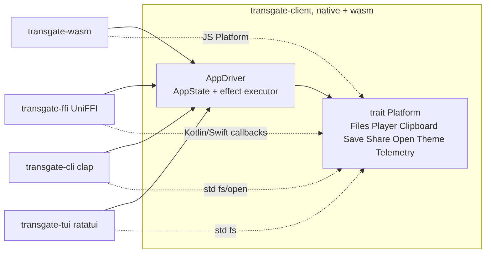

# P8 shells proposal (Fable)

Advisor `w23:p27`, anthropic/claude-fable-5-1, MEDIUM, 2026-10-27. Independent; the Opus proposal was not read. Read-only evidence: PRD P8 row and §2-8, `docs/architecture.md`, `screens.md` WEB-049..076, `transgate/core/src/presentation/app.rs`, `transgate/client/src/{lib,auth,export}.rs`, `transgate/wasm/src/{driver,platform}.rs`, `crates/taskr-ffi/src/app.rs`, `crates/taskr-{cli,tui}`, `apps/{android,ios}`, `scripts/{gen-tokens.py,build-android.sh,gen-bindings.sh}`. No builds, emulators, stubs or source writes. Names below are proposals.

## 0. Position

P8 is one refactor plus four thin shells. The refactor: the Transgate effect driver currently lives in `transgate/wasm/src/driver.rs:50-145` and is bound to the browser (`browser::navigate`, JS `Platform` at `platform.rs:14-45`). taskr already did this correctly: the controller lives in `taskr-client` and both `taskr-wasm` and `taskr-ffi` wrap it (P4 shells handoff). P8 lifts the Transgate driver into `transgate-client` behind a Rust `Platform` trait, then wasm, UniFFI, CLI and TUI all wrap the same `AppDriver`. No business rule moves; `AppState` (`app.rs:663`) stays the only state machine. Mobile carries the full signed-in app; CLI/TUI carry the PRD's smaller set over the same `AppState` with terminal-only platform ports.

## 1. Row inventory and mapping

| Rows | Shell | Core presenter already used by web | Shell-implemented ports |
|---|---|---|---|
| WEB-049, 050 sign in/out | cli, tui | `AppState` Auth (`AuthEffect::{PasswordSignIn,MagicLink,Recover,GoogleRedirect,ExchangeCallback,Refresh,SignOut}`, `app.rs:116-129`) | `AuthStorage` (file under `$TRANSGATE_HOME`, mode 0600), `Random` (OS), `Clock`, `SessionLock` (file lock); Google = system browser + loopback listener (§4) |
| WEB-051, 052 sign in/up/recovery/out | android, ios | same | `AuthStorage` = Keystore-backed prefs / Keychain (taskr `PrefsSessionVault.kt`, `KeychainSessionVault.swift`); PKCE in Rust; Custom Tabs / `ASWebAuthenticationSession` |
| WEB-053..056 upload + configuration | all four | `upload_queue` (`Effect::{MeasureDuration,CreateDraft,…}`, `upload_queue.rs:193-197`) | `Files` port: pick → `PickedFile{handle}`, `measure(handle)`, `put(handle,url,progress)`, `forget`; mirrors `platform.rs:15-19` |
| WEB-057..060 YouTube | all four | `upload_queue` YouTube add/resolve; `transcript` `Media::YouTube` | mobile: YouTube handoff opens the video in the YouTube app/browser at the seeked time (no embedded player, decision D4); cli/tui: add/resolve only, no playback |
| WEB-061, 062 list/get/delete | cli, tui | `job_list`, `transcript` read paths | none beyond HTTP |
| WEB-063, 064 list/detail/edit/playback | android, ios | `job_list`, `transcript` (`Effect::{SaveEdit,PausePlayer,ResumePlayer,Seek,LoadMediaUrl}`, `transcript.rs:99-112`) | `Player` port: ExoPlayer / AVPlayer over the signed streaming URL; `play/pause/seek/is_playing` as `platform.rs:38-44` |
| WEB-065..068 export | all four | `transcript::Effect::Export` (server ZIP) and `transgate-client::export` (client PDF with `DocumentAssetSource`, `export.rs:23-26`) | `save/share/preview` bytes: file path (cli/tui), share sheet / Files (mobile); `DocumentAssetSource` = bundle |
| WEB-069, 070 AI | android, ios | consent/analysis/chat presenters, shared `StreamState` watch (P4 UniFFI listener proof) | `copy` (clipboard), `share` for chat TXT |
| WEB-071, 072 billing handoff | android, ios | `billing` presentation, purchase/invoices | **browser handoff only**: checkout opens the web `/checkout` in the system browser; invoices PDF via `export`; no store IAP (decision D6) |
| WEB-073, 074 settings/retention/consent/delete | android, ios | `settings`, `data_management`, consent | theme port, locale from OS |
| WEB-075, 076 feedback/support/API-key handoff | android, ios | `feedback`, `support`; API keys = **web handoff** (open `/dashboard/api-keys` in browser) | none |

No row maps to a presenter the web lacks. New core work is zero presenters; the gaps are ports (§3) and one intent: `AppIntent::Started` takes `url` and `Viewport` (`app.rs:399`); native shells need a `Started` without a URL and with `Viewport::Phone` fixed, which is a small additive variant or a documented synthetic URL `/{locale}/home` (decision D1).

## 2. Architecture

### 2.1 `transgate-client::driver` (moved from wasm)

`AppDriver::new(config, api, auth, platform: Arc<dyn Platform>) -> AppDriver`; `dispatch(AppIntent, on_view: impl Fn(AppVm))`; `current() -> AppVm`; `dispose()`. The body is `driver.rs` with `browser::*` replaced by `Platform` calls and `AppEffect::{Navigate,Leave}` routed to `Platform::navigate(Route)` / `Platform::open_url`. Epoch fencing, late-answer drops and watch handling are unchanged. `MaybeSend` bounds already exist in `auth.rs:38-56` for exactly this dual target.

### 2.2 `transgate-ffi` (new, pattern `taskr-ffi/src/app.rs`)

One `#[uniffi::Object] AppPresenter::new(config, vault: Box<dyn SessionVault>, platform: Box<dyn PlatformCallbacks>)`, `dispatch(intent) -> AppView`, `dispatch_with(intent, listener)`, `current()`, `dispose()`; plus `app_preview_screens()` from `presentation::fixtures`. Records/enums are flat UniFFI mirrors of `AppVm`/`AppIntent` (the `to_view`/`to_intent` layer, `app.rs:295-390` in taskr). Callback interfaces: `SessionVault` (exists in taskr, copied not shared), `PlatformCallbacks` (files, player, clipboard, save/share, open URL, log), `AppViewListener`. Blocking calls off the main thread: single-lane dispatcher on Android, actor on iOS (architecture.md:182). The P4 `AudioSummaryListener` pattern proves streamed views across this boundary already.

### 2.3 `transgate-cli` and `transgate-tui`

Both use `AppDriver` natively with reqwest (as `taskr-cli/src/remote.rs`). CLI commands: `signin`, `signout`, `upload <files> [--language --translate-to --speakers]`, `youtube <url>`, `jobs`, `job <id>`, `transcript <id> [--original] [--out]`, `delete <id>`, `export <id> --format …`. Output: human table default, `--json` emits the `AppVm` slice. TUI: k9s style as taskr (`keymap.rs` table, hint bar), screens Jobs → Job detail (lines, tab original/translation) → Upload queue; `/` filter, `d` delete with confirm from `JobListState::confirm_delete`. Neither renders AI, billing, settings beyond sign-out, or playback (PRD P8 set).

### 2.4 Tokens

`gen-tokens.py:180-188` already emits Kotlin, Swift and TUI Rust for taskr. Add `apps/transgate-android/.../DesignTokens.kt`, `apps/transgate-ios/Transgate/DesignTokens.swift`, `transgate/tui/src/design_tokens.rs`. Shells map `Tone::{Neutral,Progress,Accent,Success,Danger}` (plus P5-D7 roles) to those tokens; no literal color in Kotlin/Swift/ratatui code (lead-owned script edit).

## 3. Ports (shell-implemented)

| Port | Android | iOS | CLI/TUI |
|---|---|---|---|
| `AuthStorage` | EncryptedSharedPreferences | Keychain (`kSecAttrAccessibleAfterFirstUnlock`) | `$TRANSGATE_HOME/session.json` 0600 |
| `SessionLock` | process mutex | actor | `flock` on the session file (CLI and TUI share it, same caveat as taskr) |
| `Files` | SAF picker, `ContentResolver` stream, `MediaMetadataRetriever` for duration, OkHttp/`HttpURLConnection` PUT with progress | `UIDocumentPicker`, `AVURLAsset.duration`, `URLSession` upload task | path args; `ffprobe` absent ⇒ `Measured{None}` (server-side duration, UPL-006 fallback already in core) |
| `Player` | ExoPlayer | AVPlayer | none (effects are no-ops; TUI shows timestamps only) |
| `Clipboard`, `Save/Share/Preview` | `ClipboardManager`, `FileProvider` share sheet | `UIPasteboard`, `UIActivityViewController` | stdout / `--out` path |
| `OpenUrl` | Custom Tabs / intent | `ASWebAuthenticationSession` (auth) and `openURL` | `xdg-open` (auth only, with `--no-browser` printing the URL) |
| `Telemetry` | `LogcatSink` | `OSLogSink` | JSON lines (stderr `-v` / log file), as taskr |
| `Theme/Locale` | system dark mode, `Locale.getDefault()` → one of 16 | `colorScheme`, `Locale.current` | `TRANSGATE_LOCALE`/`LANG`, no theme |

## 4. Auth on native

PKCE in Rust (`client::auth`) is reused unchanged. The only new thing is the return path: GoTrue redirects to `redirect_to`, which the shell registers.

- **Mobile:** `GoogleRedirect`/magic link/recovery use a custom-scheme or app-link `transgate://auth/callback?code=` (GoTrue must allow it; **P9 config**). Android: Custom Tabs + intent filter; iOS: `ASWebAuthenticationSession(callbackURLScheme:)`. The shell forwards `code` as `AuthIntent::Callback`, core emits `ExchangeCallback`, Rust exchanges with the stored verifier. Password sign-in and sign-up are in-app forms (same `AppState` auth screen as web). Decision D2: system browser, never an in-app webview.
- **CLI/TUI:** password sign-in interactive; Google/magic link via system browser with `redirect_to=http://127.0.0.1:<port>/callback` on a one-shot loopback listener (GoTrue allow-list entry; P9). `--no-browser` prints the URL and reads the pasted code.
- Refresh/401/410 handling is core (`AppEvent::{Unauthorized,AccountErased}`); the native shells only store what `AuthStorage` is told.

## 5. Uploads and playback

Upload is already presigned-URL based (`CreateDraft` → `/api/init-upload` → `put(handle,url)`); the shell streams the picked content to the URL with progress and reports HTTP 200 only (UPL-013). Handles stay shell-side (`Map<handle, Uri>`), as in web. Playback: `LoadMediaUrl` yields the 900 s streaming URL; the `Player` port loads it; `PausePlayer/ResumePlayer/Seek` are effects; current time for line highlight is shell-local. YouTube on mobile: hand off to the YouTube app/browser at the clicked time (D4), because an embedded iframe player is a web-only mechanism and native YouTube SDKs are a new dependency with licensing constraints.

## 6. Seams and ownership

| Order | Owner | Slice |
|---|---|---|
| 1 | p22 client | Move the driver into `transgate-client::driver` with `trait Platform`; re-wire `transgate-wasm` to it (behaviour-neutral; web Playwright must stay green). Publishes `Platform`, `AppDriver` signatures |
| 1 | p1X core | `AppIntent::Started` native variant or documented synthetic URL (D1); nothing else unless a shell finds a presenter gap |
| 2 | p22 ffi | `transgate-ffi` object/records/callbacks, `gen-bindings.sh` target, Linux Swift listener harness (pattern `apps/ios/p4-summary/main.swift`) |
| 2 | terminal owner (new view owner) | `transgate-cli`, `transgate-tui` with process and `TestBackend` tests |
| 3 | mobile view owner(s) | `apps/transgate-android` (Compose, signed-in flows), `apps/transgate-ios` (SwiftUI sources, XcodeGen spec), `build-android.sh`/`build-ios.sh` Transgate targets |
| — | p1T host | none expected; the only candidate is a GoTrue `redirect_to` allow-list entry, which is deployment config (P9), not a route |
| — | lead | `gen-tokens.py` outputs, workspace members, lock, Waydroid/Swift runtime |
| 4 | Y | §8 |

## 7. Decisions

| ID | Question | Recommendation |
|---|---|---|
| D1 | Native `Started` | Additive `AppIntent::StartedNative { locale, utc_offset_minutes }`, viewport fixed to phone; avoids fake URLs |
| D2 | Native auth UI | In-app email/password forms over the shared auth state; redirect flows via system browser (Custom Tabs / `ASWebAuthenticationSession`); no webview |
| D3 | Driver location | Move to `transgate-client`; wasm becomes a wrapper (as taskr). Prerequisite for every shell |
| D4 | YouTube on mobile | Handoff to YouTube app/browser at time; no embedded player SDK |
| D5 | CLI/TUI scope | PRD set only: sign in, upload, list, fetch transcript/translation, export, delete, YouTube add; no AI/billing/settings |
| D6 | Mobile purchases | Browser handoff to web checkout; invoices via shared PDF export; no IAP. iOS App Store policy risk recorded as a P9/live gap, not solved in P8 |
| D7 | API keys on mobile | Browser handoff to `/dashboard/api-keys` (WEB-075/076 wording "not new native admin scope") |
| D8 | CLI duration | `Measured{None}` without `ffprobe`; core's server-side duration path handles it |
| D9 | Tokens | Three new generator outputs; semantic tones only |

## 8. Acceptance (Y)

| Check | Proof |
|---|---|
| Driver move | Existing Transgate web Playwright desktop+phone stay green against the rewired wasm; `cargo test -p transgate-client driver::` covers epoch drop, 401→refresh→sign-in, native `Started` |
| Bindings | `gen-bindings.sh --check` clean; generated Kotlin compiles on JVM smoke; generated Swift + `AppModel.swift` compile and run on Linux Swift (pinned `swift:6.2-noble` as P4) |
| Linux Swift listener | Harness signs in with password against the owned runtime (server, PG, GoTrue, loopback provider), uploads a real file via presigned PUT, polls to completed, reads lines, exports, signs out; prints `P8_UNIFFI_PASS` with named steps |
| Waydroid APK | `build-android.sh` x86_64; signed-in flow: password sign-in, pick a bundled test file via SAF, upload, job completes through the loopback provider, transcript shown, one line edited, export shared to Files, sign out. Evidence: logcat + screenshots per step |
| CLI | Process tests (`assert_cmd` pattern of `taskr-cli/tests/cli.rs`) against the owned runtime: signin, upload, jobs, transcript, export bytes compared with the server ZIP, delete, exit codes, `--json` shape |
| TUI | `TestBackend` render tests from `presentation::fixtures` (jobs list, detail original/translation, confirm delete, upload progress) plus key-table tests against the real driver with a fake API |
| Mac steps | `build-ios.sh` documented for xcframework + XcodeGen; not executed here |
| Tokens | `gen-tokens.py --check` |
| Live gaps | Google OAuth on device, App Store/Play policies, real device audio, push notifications (not in source, none added) |

Nothing here authorizes implementation.
