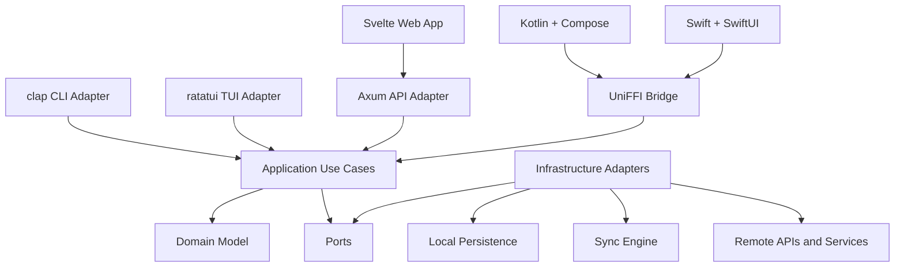
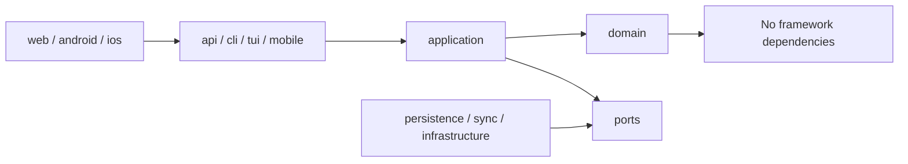

# Rust Multiplatform Application Architecture

## Goals

- Keep business rules and application behavior in a shared Rust core.
- Use domain-driven design with hexagonal architecture to isolate the core from delivery mechanisms and infrastructure.
- Apply MVVM only at UI boundaries, where view state and user interaction need it.
- Support a server, CLI, TUI, web app, Android app, and iOS app without duplicating business logic.
- Favor explicit boundaries, small interfaces, and predictable data flow for AI-assisted maintainability.
- Preserve Rust performance, safety, and testability across platforms.

## Architecture



The domain and application layers define behavior. Every user interface and delivery mechanism is an adapter. Infrastructure implements ports owned by the core.

## Shared Rust Core

### Domain

The domain contains entities, value objects, invariants, domain services, and domain errors. It should remain independent of UI frameworks, databases, networking libraries, and serialization formats where practical.

### Application

The application layer coordinates use cases and transactions. It accepts commands or queries, invokes domain behavior, and works through ports.

```rust
pub struct CreateProject<R> {
    repository: R,
}

impl<R: ProjectRepository> CreateProject<R> {
    pub async fn execute(
        &self,
        command: CreateProjectCommand,
    ) -> Result<Project, CreateProjectError> {
        let project = Project::create(command.name)?;
        self.repository.save(&project).await?;
        Ok(project)
    }
}
```

### Ports

Ports are interfaces required by application use cases, such as repositories, clocks, identity providers, network clients, event publishers, and transaction boundaries. They prevent infrastructure concerns from leaking into the core.

### Infrastructure

Infrastructure adapters implement ports for databases, filesystems, operating-system services, remote APIs, telemetry, and authentication. Keep platform-specific implementations behind the same core interfaces where behavior is shared.

### Local Persistence and Sync

Local persistence should be a first-class adapter, not UI-owned storage. The sync engine should operate through application and repository boundaries and explicitly model:

- Local changes and durable operation queues
- Remote versions and synchronization checkpoints
- Conflict detection and resolution rules
- Retry, idempotency, and offline behavior
- Migrations and backward compatibility

## Delivery Adapters

### Axum Server

Axum routes translate HTTP requests into application commands and queries, then translate results into API responses. Route handlers should not contain business rules.

### clap CLI

The CLI parses arguments, invokes the same application use cases, and formats results for scripts and humans. Stable exit codes and optional structured output make it useful for automation.

### ratatui TUI

The TUI owns terminal state, input handling, rendering, and view models. It should call application use cases rather than repositories or infrastructure directly.

## Web Application

Use Svelte with TypeScript and Vite as the default web stack. It provides a small presentation layer, direct component reactivity, fast development, and limited ceremony around an API-driven Rust backend.

SvelteKit is useful when server-side rendering, filesystem routing, server actions, or web-specific backend behavior is required. It is not necessary for a client application that primarily consumes Axum APIs.

Remix adds a server-oriented full-stack model that may duplicate responsibilities already owned by the Rust backend. HTMX is attractive for server-rendered interactions but becomes less suitable as rich local state, offline behavior, and complex client workflows grow. Plain JavaScript minimizes tooling but gives up TypeScript's contracts and scales less safely across a substantial UI.

## Mobile Applications

### Android

Use Kotlin and Jetpack Compose for the native UI. Keep Android lifecycle, permissions, navigation, and view state in Kotlin. Call shared use cases through generated UniFFI bindings.

### iOS

Use Swift and SwiftUI for the native UI. Keep Apple platform integration, navigation, and view state in Swift. The SwiftUI layer can follow MVVM while delegating business operations to the shared Rust core through UniFFI.

### UniFFI Bridge

UniFFI exposes a deliberate mobile-facing API from Rust and generates Kotlin and Swift bindings. The bridge should use stable data-transfer types and coarse-grained use cases instead of exposing internal domain objects or low-level repository operations.

Treat the FFI boundary as a public API. Define ownership, threading, cancellation, error mapping, and compatibility behavior explicitly. Avoid frequent chatty calls across the boundary.

## iOS Development from Linux

Most shared Rust logic can be developed and tested on Linux. Android, web, CLI, TUI, server, persistence, and sync development can also remain Linux-first.

The standard iOS toolchain still requires macOS and Xcode for the Apple SDK, SwiftUI compilation, simulator and device testing, code signing, provisioning, archives, and App Store submission. A practical workflow is:

```text
Linux development
  -> test shared Rust core
  -> generate and validate UniFFI bindings
  -> push changes
  -> macOS CI builds and tests the iOS application
  -> use a Mac for simulator, device, signing, and release work
```

Cross-compilation experiments can reduce friction in narrow cases, but they should not replace the supported Xcode pipeline for a long-lived product.

## Recommended Repository Structure

```text
.
├── Cargo.toml
├── crates/
│   ├── domain/             # Entities, value objects, invariants
│   ├── application/        # Commands, queries, and use cases
│   ├── ports/              # Core-owned interfaces
│   ├── infrastructure/     # Shared infrastructure adapters
│   ├── persistence/        # Local database and migrations
│   ├── sync/               # Offline queue and synchronization
│   ├── api/                # Axum adapter
│   ├── cli/                # clap adapter
│   ├── tui/                # ratatui adapter
│   └── mobile/             # UniFFI facade and bindings
└── apps/
    ├── web/                # Svelte, TypeScript, Vite
    ├── android/            # Kotlin, Jetpack Compose
    └── ios/                # Swift, SwiftUI, Xcode project
```

Split infrastructure into narrower crates only when compile times, ownership, feature flags, or dependency isolation justify it. Keep the dependency direction toward the domain and application core.



## Testing Strategy

- Test domain invariants with fast unit and property-based tests.
- Test application use cases with in-memory or controlled fake port implementations.
- Run contract tests against every repository, sync, and external-service adapter.
- Test persistence migrations against realistic databases and upgrade paths.
- Test sync under retries, conflicts, duplicated operations, interrupted writes, and offline transitions.
- Test Axum endpoints at the HTTP boundary and CLI behavior through process-level integration tests.
- Test TUI state transitions separately from terminal rendering where possible.
- Test UniFFI bindings from Kotlin and Swift, including error conversion, threading, and cancellation.
- Use web and mobile UI tests for critical user journeys, while keeping most behavioral coverage in Rust.
- Build all supported targets in CI, with macOS runners responsible for iOS compilation and tests.

## Implementation Principles

1. Put business decisions in the domain or application layer, never in UI adapters.
2. Make dependencies point inward and let the core own its required interfaces.
3. Keep adapters thin and translation-focused.
4. Design the UniFFI surface intentionally and version it like an external API.
5. Prefer explicit commands, queries, errors, and state transitions over framework magic.
6. Keep platform-native UI behavior native while sharing non-UI behavior in Rust.
7. Make offline and synchronization semantics part of the product model, not an afterthought.
8. Use small modules, stable boundaries, and deterministic tests to improve human and AI-assisted maintenance.
9. Measure before optimizing, then optimize shared Rust paths that materially affect user experience.
10. Add framework layers only when their concrete capabilities are needed.
